# vfat32

**A FAT32 file system that lives in RAM, with the C file API you already know.**

You give vfat32 a block of memory — a static array, a `calloc`ed buffer, retained RAM on a microcontroller — and it
turns it into a real FAT32 volume. Then you use it the way you use files in C: `fopen`, `fgets`, `fprintf`,
`fread`, `fwrite`, `fseek`, `open`, `read`, `write`, `lseek`, `mkdir`, `opendir`, `readdir`, `rename`, `remove`,
`stat` — as members of one object, `vfat32::vfs`.

Because the memory **is** a FAT32 image, byte for byte, you can save it to a file and check it with your computer's
own `fsck`, mount it on Linux or macOS, or load an image made by a PC and work on it.

- **C++11, no STL, no exceptions, no RTTI, no heap** (the volume may optionally be `calloc`ed). The same code runs on
  a PC, an ESP32, an STM32 or an AVR with enough RAM.
- **Buffered streams** (`fopen` family, `setvbuf`) **and unbuffered descriptors** (`open` family), many files open at
  once, long file names in UTF-8.
- **Format, reuse, or ask first**: `needs_format()` tells you whether a complete FAT32 is already there.
- **Integrity check with repair** and **in-place, incremental defragmentation**, both with O(1) extra RAM.
- **Thread safety is yours, with one hook**: give it a recursive mutex and every call becomes atomic.

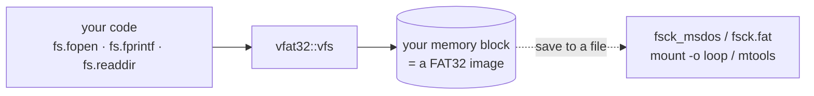

The normative specification is [`spec.md`](spec.md): every rule quoted below (`F5`, `B2`, `T3`, …) is defined
there.

---

## Contents

1. [Quick start](#1-quick-start)
2. [Features and limits](#2-features-and-limits)
3. [Building and integrating](#3-building-and-integrating)
4. [How it works](#4-how-it-works)
5. [Mounting: format, reuse, needs_format](#5-mounting-format-reuse-needs_format)
6. [Files: buffered streams and unbuffered descriptors](#6-files-buffered-streams-and-unbuffered-descriptors)
7. [Directories, paths and names](#7-directories-paths-and-names)
8. [Errors](#8-errors)
9. [Thread safety](#9-thread-safety)
10. [Integrity check and repair](#10-integrity-check-and-repair)
11. [Defragmentation](#11-defragmentation)
12. [Images and interoperability](#12-images-and-interoperability)
13. [Microcontrollers](#13-microcontrollers)
14. [API reference](#14-api-reference)
15. [Testing](#15-testing)
16. [Limits and open problems](#16-limits-and-open-problems)
17. [License](#17-license)

---

## 1. Quick start

```cpp
#include "vfat32.hpp"
#include <stdio.h>

static uint8_t ram[256 * 1024];          // the volume: any memory you own

int main() {
    vfat32::vfs fs;
    if (fs.mount(ram, sizeof ram, vfat32::mount_mode::format_if_needed) != 0) {
        printf("mount: %s\n", vfat32::vfs::strerror(fs.last_error()));
        return 1;
    }

    fs.mkdir("/logs");
    vfat32::file* f = fs.fopen("/logs/Hello World.txt", "w");
    fs.fprintf(f, "boot #%d\n", 1);
    fs.fclose(f);

    char line[64];
    f = fs.fopen("/logs/hello world.txt", "r");   // names are case-insensitive
    while (fs.fgets(line, sizeof line, f)) printf("%s", line);
    fs.fclose(f);

    vfat32::dir* d = fs.opendir("/logs");
    while (vfat32::dirent* e = fs.readdir(d)) printf("%-20s %u bytes\n", e->d_name, e->d_size);
    fs.closedir(d);

    fs.umount();
}
```

```sh
c++ -std=c++11 -Isrc my_app.cpp src/*.cpp -o my_app      # or: make && link build/libvfat32.a
```

More complete programs are in [`examples/`](examples) (§3.3).

---

## 2. Features and limits

| Area | What you get | Rules |
|---|---|---|
| Format | FAT32 layout on any memory from 3 KiB up to 2³² sectors; 512–4096-byte sectors; 1 or 2 FAT copies; automatic or chosen cluster size | §4.1 F1–F7 |
| Start-up | `mount` with `reuse`, `format` or `format_if_needed`; static `needs_format(mem, size)`; `was_dirty()` after an unclean stop | §5 |
| Memory | yours (any pointer, no alignment needed) or `calloc`ed by `mount(size)` | M1, M2 |
| Streams | `fopen` modes `r w a r+ w+ a+ x b`, `setvbuf` full/line/none, own or user buffer, `fgets`, `fprintf`, `ungetc`, `fgetpos` | §7.3 |
| Descriptors | `open` with `o_rdonly o_wronly o_rdwr o_creat o_excl o_trunc o_append`, `read`, `write`, `lseek`, `ftruncate`, `fsync`, `fstat` | §7.4 |
| Open files | `VFAT32_MAX_OPEN_FILES` handles (default 8), several on the same file, readers coherent with writers | §7.1, D5 |
| Directories | `mkdir`, `rmdir`, `opendir`, `readdir`, `rewinddir`, `closedir`, `rename` (POSIX), `remove`, `unlink`, `stat`, `truncate` | §8 |
| Names | long names up to 255 characters, UTF-8, case-insensitive, 8.3 aliases | §4.7 |
| Integrity | `check(report, repair)`: lost clusters, cross-links, broken chains, sizes, `.`/`..`, FAT copies, FSInfo | §11 |
| Defrag | `defrag(max_moves)`: every file one run, free space one run at the end, in place, incremental | §12 |
| Threads | optional recursive lock object; `flockfile`/`funlockfile` for atomic groups | §10 |
| Portability | C++11, C headers only; tested on macOS (clang), AVR (avr-g++ 7.3), ESP32 (xtensa gcc); Linux via CI | §14 |

What it is **not**: there is no `chmod`, `utime`, `chdir`, `mmap` or file locking; case folding is ASCII-only; volumes
under 65,525 clusters are not mountable by Windows (Linux and macOS mount them) — see §16.

---

## 3. Building and integrating

### 3.1 Files

The library is five `.cpp` files and two headers in [`src/`](src):

| File | Content |
|---|---|
| `vfat32.hpp` | the whole public API and the configuration macros — the only header you include |
| `vfat32_internal.hpp` | on-disk constants and byte helpers (internal) |
| `vfat32_volume.cpp` | probe, format, mount, FAT primitives, errors |
| `vfat32_name.cpp` | UTF-8 ↔ UTF-16, name rules, 8.3 aliases |
| `vfat32_dir.cpp` | directories, paths, `rename`, `stat` |
| `vfat32_file.cpp` | handles, streams, descriptors |
| `vfat32_check.cpp` | `check` and `defrag` |

Add `src/*.cpp` to your build and `src` to the include path. Nothing else is needed: no other library, no generated
file, no global state.

### 3.2 Make targets

| Target | What it does |
|---|---|
| `make` | `build/libvfat32.a`, the test runner, the PC examples, the figure tool |
| `make test` | all tests (unit, random stress, threads, external `fsck`) |
| `make test_long` | the random stress test with many more operations and seeds |
| `make test_asan` | all tests under AddressSanitizer + UndefinedBehaviorSanitizer |
| `make test_tsan` | the threads test under ThreadSanitizer |
| `make check_embedded` | AVR and ESP32 builds of the library; proves no heap/exception/RTTI symbol is referenced; sizes |
| `make arduino_check` | compiles the Arduino sketches with `arduino-cli` (ESP32 and Mega 2560) |
| `make docs` | regenerates `docs/figures/*.svg` from the real code |
| `make examples` | builds the PC examples into `bin/` |

### 3.3 Examples

| Example | Shows |
|---|---|
| [`examples/pc/quick_start.cpp`](examples/pc/quick_start.cpp) | mount, directories, streams, listing, `statvfs` |
| [`examples/pc/buffered_vs_unbuffered.cpp`](examples/pc/buffered_vs_unbuffered.cpp) | `setvbuf` modes, user buffers, descriptor I/O, speed of each (§6.4) |
| [`examples/pc/image_file.cpp`](examples/pc/image_file.cpp) | keep a volume in a file across runs; `needs_format`, `reuse`, `was_dirty`, `check` |
| [`examples/pc/threads.cpp`](examples/pc/threads.cpp) | a recursive pthread mutex as the lock; `flockfile` groups; `last_error` in threads |
| [`examples/pc/defrag_demo.cpp`](examples/pc/defrag_demo.cpp) | fragmenting a volume and defragmenting it incrementally |
| [`examples/arduino/vfat32_basic`](examples/arduino/vfat32_basic) | Arduino sketch for ESP32 and AVR (Mega 2560) |
| [`examples/arduino/vfat32_retained_ram`](examples/arduino/vfat32_retained_ram) | ESP32: a volume in no-init RAM that survives resets (`reuse` + `check`) |

### 3.4 Configuration

Set these with `-D` on the compiler command line (spec §13). On AVR the defaults are already small (§13.1).

| Macro | Default | AVR default | Meaning |
|---|---|---|---|
| `VFAT32_MAX_OPEN_FILES` | 8 | 2 | handle rows (streams + descriptors), 1–255 |
| `VFAT32_MAX_OPEN_DIRS` | 4 | 1 | `dir` rows, 1–255 |
| `VFAT32_BUFFER_SIZE` | 512 | 32 | each handle's own stream buffer in bytes; 0 = none (streams start unbuffered) |
| `VFAT32_NAME_MAX` | 255 | 32 | longest name component in UTF-8 bytes (12–1020) |
| `VFAT32_PRINTF_MAX` | 256 | 64 | `fprintf` stack buffer: the longest output of one call + 1 |
| `VFAT32_USE_HEAP` | 1 | 1 | 0 removes `mount(size)` and every use of `calloc`/`free` |

The `vfs` object holds every table, so its size is your whole RAM cost besides the volume (measured):

| Configuration | PC (64-bit) | ESP32 | AVR |
|---|---|---|---|
| defaults | 6,848 B | 6,668 B | — |
| AVR defaults (2 files, 1 dir, 32 B buffers, 32 B names) | — | — | 383 B |
| 4 files, 2 dirs, 128 B buffers, 64 B names | 1,328 B | 1,208 B | — |
| 2 files, 1 dir, no buffers, 12 B names | 352 B | — | — |

---

## 4. How it works

### 4.1 The volume layout

Your memory is cut into **sectors** (512 bytes by default). The first sectors are the **reserved region**: the boot
sector with the volume's geometry (the BPB), the FSInfo sector with the free-space count, and on bigger volumes a
backup of both. Then come one or two copies of the **FAT** (File Allocation Table), and then the **data region**, cut
into **clusters**, where files and directories live. This picture is drawn by `make docs` from a real 1 MiB volume
formatted by vfat32 and read back from its bytes:

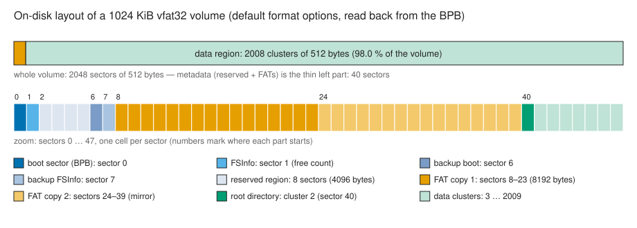

| Part | Size (1 MiB volume, defaults) | Rule |
|---|---|---|
| boot sector + FSInfo + backups | 8 sectors (32 on volumes ≥ 4096 sectors, 2 below 128) | F3 |
| FAT copy 1 and 2 | 16 sectors each: 4 bytes per cluster | F4, F5 |
| data region | 2008 clusters of 512 bytes; cluster 2 is the root directory | F2 |

### 4.2 Clusters and chains

A file is a **chain** of clusters. Its directory entry holds the first cluster; the FAT entry of each cluster holds
the number of the next one, and the last holds an end-of-chain mark. Free clusters hold 0.

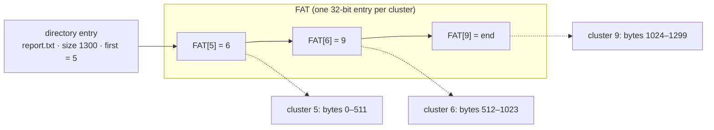

A file of size *s* always owns exactly ⌈*s* / cluster⌉ clusters (rule W1), after every call — so the memory is a valid
FAT32 at any moment between calls (D2): you can snapshot it, or an MCU can reset, without a half-written structure
(stream buffers aside).

### 4.3 Directory entries and long names

A directory is a chain too, holding 32-byte **slots**. A name that fits the old 8.3 form (`README.TXT`, or
`readme.txt` thanks to the NT case flags) takes one slot. A longer name takes extra **LFN slots** before it, each
holding 13 UTF-16 characters, plus an 8.3 **alias** that old systems see:

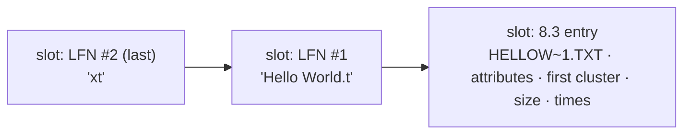

### 4.4 Handles: streams and descriptors share one table

Every open file is a row in a fixed table inside the `vfs` object. A `vfat32::file*` (stream) and an `int`
(descriptor) are two names for the same kind of row: `fileno(f)` is its index. Rows point at the file's directory
entry, so every handle on the same file sees the same size and clusters (D1).

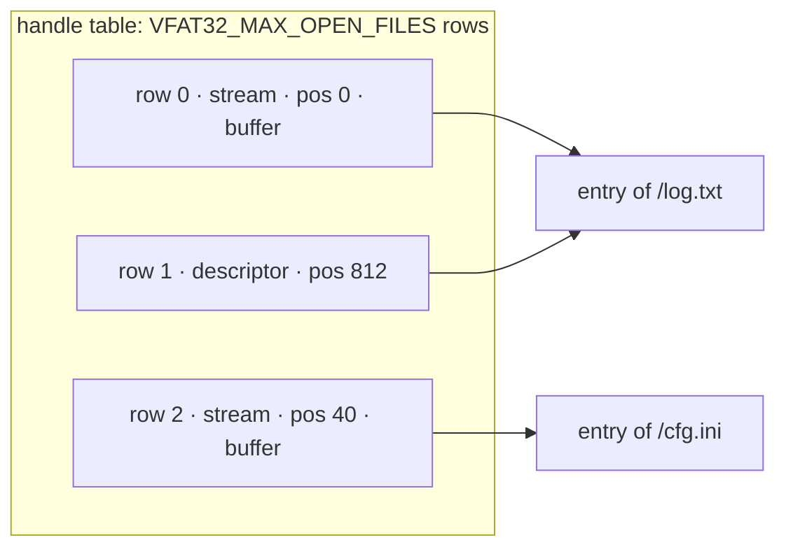

---

## 5. Mounting: format, reuse, needs_format

### 5.1 The decision

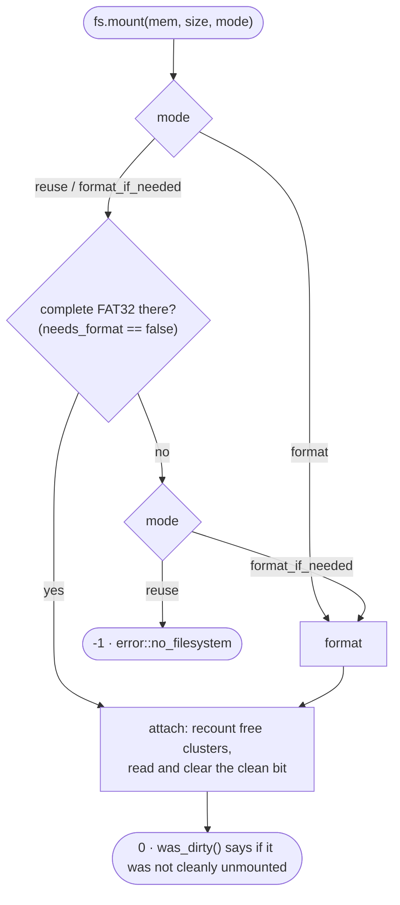

```cpp
// Ask without touching anything (static, no lock, read-only):
bool blank = vfat32::vfs::needs_format(mem, size);   // false = a complete FAT32 is there

fs.mount(mem, size, vfat32::mount_mode::reuse);             // keep it; fail if there is none
fs.mount(mem, size, vfat32::mount_mode::format);            // always start empty
fs.mount(mem, size, vfat32::mount_mode::format_if_needed);  // keep it if valid, else format
```

`needs_format` answers **no** only when every structural rule P1–P12 of the spec holds: boot signature, jump
instruction, sector and cluster sizes, the FAT32 fields (`RootEntCnt = 0`, `FATSz16 = 0`, `FSVer = 0`, …), the media
byte, a volume that fits in your memory, a FAT big enough for its clusters, a valid root cluster and a matching
`FAT[0]`. It checks the structure, not every file: use `check()` (§10) for that. A memory block larger than the
volume is fine; a smaller one is not (the image would be truncated).

### 5.2 Format options

```cpp
vfat32::format_options o;          // defaults below
o.bytes_per_sector = 512;          // 512, 1024, 2048, 4096
o.sectors_per_cluster = 0;         // 0 = automatic (512 B clusters up to 260 MiB, then Microsoft's table)
o.fat_copies = 2;                  // 1 saves RAM on MCUs; 2 lets check() compare them
o.reserved_sectors = 0;            // 0 = automatic: 2, 8 or 32 (F3)
o.volume_id = 0;                   // 0 = from the clock
strcpy(o.volume_label, "DATALOG"); // up to 11 characters
fs.mount(mem, size, vfat32::mount_mode::format, &o);
```

The smallest volume is 3 KiB with defaults (2.5 KiB with one FAT copy): six 512-byte sectors, two clusters. A
smaller memory fails with `error::no_space`. `fs.format(&o)` re-formats a mounted volume in place (no handle may be
open).

### 5.3 Memory: yours or calloc'ed

```cpp
static uint8_t ram[64 * 1024];
fs.mount(ram, sizeof ram, vfat32::mount_mode::format_if_needed);   // yours: it stays yours after umount

fs.mount(1024 * 1024);              // calloc'ed and formatted; umount() frees it (VFAT32_USE_HEAP=1)
```

### 5.4 Unmounting and the clean bit

`umount()` flushes and closes every open handle, sets the FAT's **clean-shutdown bit** and writes FSInfo; the
destructor calls it. `mount` clears the bit while the volume is in use, so a later `mount(reuse)` knows whether the
previous session ended cleanly:

```cpp
fs.mount(retained_ram, size, vfat32::mount_mode::format_if_needed);
if (fs.was_dirty()) {                 // the MCU reset while mounted
    vfat32::check_report r;
    fs.check(&r, true);               // frees clusters an interrupted call allocated but never linked
}
```

`sync()` flushes every stream and writes FSInfo without unmounting (the clean bit stays clear).

---

## 6. Files: buffered streams and unbuffered descriptors

### 6.1 Streams (`fopen` family) — buffered

| Mode | File must exist | Creates | Truncates | Reads | Writes |
|---|---|---|---|---|---|
| `"r"` | yes | — | — | yes | — |
| `"w"` | — | yes | yes | — | at the position |
| `"a"` | — | yes | — | — | always at the end |
| `"r+"` | yes | — | — | yes | at the position |
| `"w+"` | — | yes | yes | yes | at the position |
| `"a+"` | — | yes | — | yes (from 0) | always at the end |
| `"wx"`, `"w+x"` | must **not** exist (`error::exists`) | yes | — | as `w`/`w+` | as `w`/`w+` |

`b` and `t` are accepted and ignored (there is no text mode). A stream has a buffer from the start (its row's own
`VFAT32_BUFFER_SIZE` bytes); `setvbuf` changes it at any time (pending data is flushed first):

```cpp
vfat32::file* f = fs.fopen("/data.csv", "w");
fs.setvbuf(f, nullptr, vfat32::io_lbf, 0);              // line buffered: each '\n' reaches the volume
static char big[4096];
fs.setvbuf(f, big, vfat32::io_fbf, sizeof big);         // your buffer (must outlive the stream)
fs.setvbuf(f, nullptr, vfat32::io_nbf, 0);              // unbuffered stream
```

How a stream's buffer behaves:

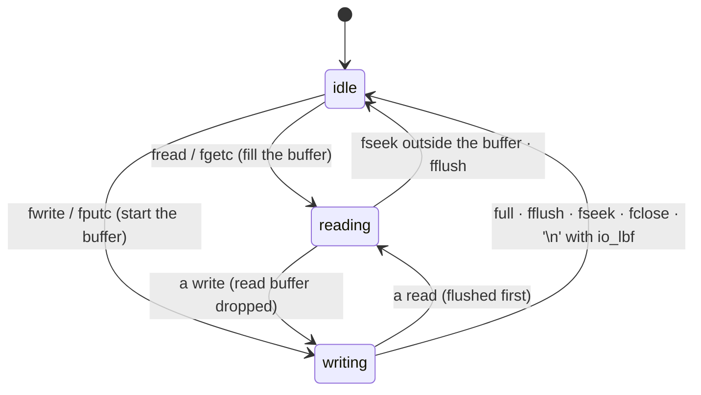

- Reads and writes at least as large as the buffer go straight to the volume (no double copy, B3).
- You do not need `fflush`/`fseek` between reading and writing on the same stream (B4).
- `fprintf` formats into a stack buffer of `VFAT32_PRINTF_MAX` bytes; output that does not fit fails with
  `error::invalid` and writes nothing (D14) — it is never silently cut.
- `ftell`/`fseek` use `long`; `fgetpos`/`fsetpos` reach every position up to 4 GiB − 1 (B8).

### 6.2 Descriptors (`open` family) — unbuffered

```cpp
int fd = fs.open("/raw.bin", vfat32::o_rdwr | vfat32::o_creat | vfat32::o_trunc);
fs.write(fd, samples, sizeof samples);      // straight into the volume
fs.lseek(fd, 0, vfat32::seek_set);
long n = fs.read(fd, back, sizeof back);
fs.ftruncate(fd, 1024);                     // shrink, or grow with zeros
fs.close(fd);
```

`read` and `write` return `long` (`-1` on error). When the volume fills, `write` returns a short count and the next
call fails with `error::no_space`. Use the `vfat32::` constants (`o_creat`, `seek_set`, …), never the host's
`O_CREAT`/`SEEK_SET` macros (D16; `seek_*` are checked equal to the host's at compile time).

### 6.3 Many open files

- Up to `VFAT32_MAX_OPEN_FILES` handles at once, in any mix of streams and descriptors; the next open fails with
  `error::too_many_open`.
- Several handles may be open on the same file, for reading and writing. They share one size and one chain.
- **Read buffers are coherent**: a write through any handle drops the read buffers of the other handles on that file,
  so readers never see stale data. **Write buffers are private**, as in stdio: a stream's buffered data is visible to
  the others after it is flushed (D5).
- Shrinking a file through one handle resets the cluster caches and read buffers of all its handles (H4).
- An open file can be renamed — its handles follow it (H5) — but not removed (`error::busy`, D8).
- The modification time is written when a modified handle is flushed, synced or closed (D9).

### 6.4 Buffered or unbuffered?

All data is in RAM, so "unbuffered" does not mean "slow device"; it means **every call goes all the way down**: lock,
handle check, cluster lookup, copy, size update. A buffer turns many small calls into few large ones. Measured with
[`buffered_vs_unbuffered`](examples/pc/buffered_vs_unbuffered.cpp) (8 MiB per method, Apple M-series, `-O2`):

| Method | Speed |
|---|---|
| `fputc`, `io_fbf` (row's 512 B buffer) | ≈ 470 MiB/s |
| `fputc`, `io_fbf` (4 KiB user buffer) | ≈ 470 MiB/s |
| `fputc`, `io_lbf` (a `'\n'` every 64 B) | ≈ 410 MiB/s |
| `fputc`, `io_nbf` (unbuffered stream) | ≈ 75 MiB/s |
| `write(fd, 1 byte)` | ≈ 87 MiB/s |
| `fwrite` / `write` of 4 KiB blocks | ≈ 24 GiB/s (memory copy speed) |

Rules of thumb: many small writes (logs, text, `fprintf`) → stream with a buffer; big blocks → either (they bypass
the buffer); data that another handle must see at once → descriptor, or a stream with `io_nbf`/`io_lbf`, or `fflush`.

---

## 7. Directories, paths and names

### 7.1 Paths

- Separator `/`; repeated separators count once; the leading `/` is optional (`"a/b"` = `"/a/b"`); `""` and `"/"`
  are the root (S1).
- `.` and `..` work in any position; `..` of the root is the root (S2). There is no current directory (D12).
- A trailing `/` demands a directory (S3).

### 7.2 Directory calls

```cpp
fs.mkdir("/data");
fs.mkdir("/data/2026");
vfat32::dir* d = fs.opendir("/data");
while (vfat32::dirent* e = fs.readdir(d))
    printf("%s %s %u\n", e->d_type == vfat32::dt_dir ? "DIR " : "FILE", e->d_name, e->d_size);
fs.rewinddir(d);
fs.closedir(d);
fs.rmdir("/data/2026");           // must be empty and not open
```

- `readdir` never returns `.` or `..` (D11) nor the volume label. The `dirent` it returns lives in the `dir` row
  until the next `readdir`/`closedir` on it.
- Up to `VFAT32_MAX_OPEN_DIRS` directories open at once.
- `remove` deletes a file or an empty directory; `unlink` only files; `rmdir` only directories.

### 7.3 rename (POSIX semantics, D7)

| Situation | Result |
|---|---|
| target does not exist | moved/renamed; directories may change parent (their `..` is rewritten) |
| target is a file, source a file | target replaced |
| target is an empty directory, source a directory | target replaced |
| target is a non-empty directory | `error::not_empty` |
| file onto directory / directory onto file | `error::is_directory` / `error::not_directory` |
| directory into its own subtree | `error::invalid` |
| target open | `error::busy` |
| source open | allowed: its handles follow |
| case only (`a.txt` → `A.txt`) | allowed |
| no room for the new entry | `error::no_space`, nothing changed |

### 7.4 stat

```cpp
struct vfat32::stat st;
fs.stat("/data/log.txt", &st);
// st.st_mode (s_isdir/s_isreg), st.st_size, st.st_attr (attr_read_only, attr_hidden, …),
// st.st_modified, st.st_created, st.st_accessed (date only) as {year, month, day, hour, minute, second}
```

The time fields are not called `st_mtime`/`st_atime`/`st_birthtime` on purpose: those names are macros in the
macOS, glibc and newlib system headers. Times come from your clock (`set_clock`); without one they are
1980-01-01 00:00:00.

```cpp
vfat32::timestamp my_clock() { return {2026, 10, 28, 14, 30, 0}; }   // from your RTC
fs.set_clock(my_clock);
```

### 7.5 Names

| You create | Stored as | Notes |
|---|---|---|
| `README.TXT` | 8.3 only | fits exactly (N4) |
| `readme.txt` | 8.3 only, lower-case flags | Linux and Windows show `readme.txt` |
| `ReadMe.txt` | long name + alias `README.TXT` | mixed case needs a long name |
| `Hello World.txt` | long name + alias `HELLOW~1.TXT` | spaces are not 8.3 |
| `Relatório 中文 😀.txt` | long name (UTF-16) + alias `RELAT_~1.TXT` | UTF-8 in the API |

- Names are compared case-insensitively for ASCII letters (D13): `fopen("/HELLO WORLD.TXT")` finds
  `Hello World.txt`. The 8.3 alias opens the file too (N6).
- Up to 255 characters per component and `VFAT32_NAME_MAX` bytes of UTF-8 (N2).
- Not allowed in new names: control characters, `" * / : < > ? \ |`, a trailing `.` or space, `.`/`..` (N3).

---

## 8. Errors

Functions follow C: they return `NULL`, `-1` or `EOF` and set the volume's `last_error()`; a successful call does not
clear it (D15). Streams also keep their own `ferror`/`feof` flags.

```cpp
vfat32::file* f = fs.fopen("/missing.txt", "r");
if (!f) printf("fopen: %s\n", vfat32::vfs::strerror(fs.last_error()));   // "no such file or directory"
```

| `vfat32::error` | Like | Typical cause |
|---|---|---|
| `not_found` | ENOENT | path component missing |
| `exists` | EEXIST | `mkdir`, `o_excl`, `"wx"` on an existing name |
| `no_space` | ENOSPC | volume full; directory at 65,536 slots; memory too small to format |
| `bad_handle` | EBADF | closed/unknown handle; reading a write-only handle |
| `invalid` | EINVAL | bad argument, mode or name; `fprintf` output too long; rename into own subtree |
| `is_directory` / `not_directory` | EISDIR / ENOTDIR | wrong kind of object |
| `not_empty` | ENOTEMPTY | `rmdir` of a non-empty directory |
| `busy` | EBUSY | file or directory open; handles open during `format`/`defrag`/repair; already mounted |
| `too_many_open` | EMFILE | no free handle row |
| `name_too_long` | ENAMETOOLONG | name component too long |
| `access` | EACCES | writing a read-only file |
| `file_too_big` | EFBIG | 4 GiB − 1 reached |
| `overflow` | EOVERFLOW | `ftell`/`lseek` position does not fit in `long` |
| `not_mounted` | ENODEV | no volume |
| `no_memory` | ENOMEM | `calloc` failed; `setvbuf` with no buffer available |
| `no_filesystem` | — | `mount(reuse)` on memory without a complete FAT32 |
| `corrupt` | EIO | broken structure found; `check` found errors; `defrag` on a damaged volume |

---

## 9. Thread safety

### 9.1 The model, in plain words

vfat32 does not know your operating system, so it cannot create a mutex by itself, and it does not pretend to be
thread-safe on its own. **Thread safety is your responsibility** — but vfat32 gives you exactly one hook to make it
easy and correct: give it an object with `lock()` and `unlock()`, and **every member call runs inside that lock**.

- No lock installed (the default): zero overhead, right for single-threaded programs and cooperative schedulers.
- Lock installed: any thread may call any member at any time; each call is atomic with respect to the others.
- One lock per volume, taken by every call: there is no lock ordering problem inside vfat32.

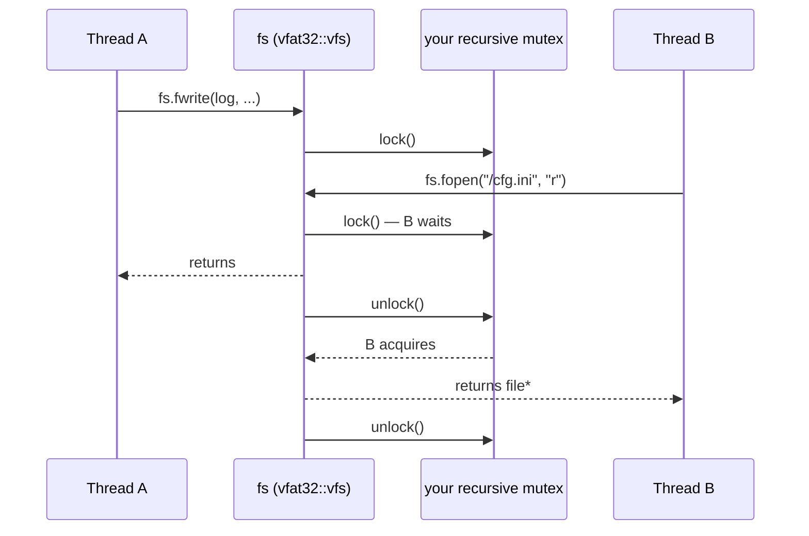

### 9.2 Do you need a lock?

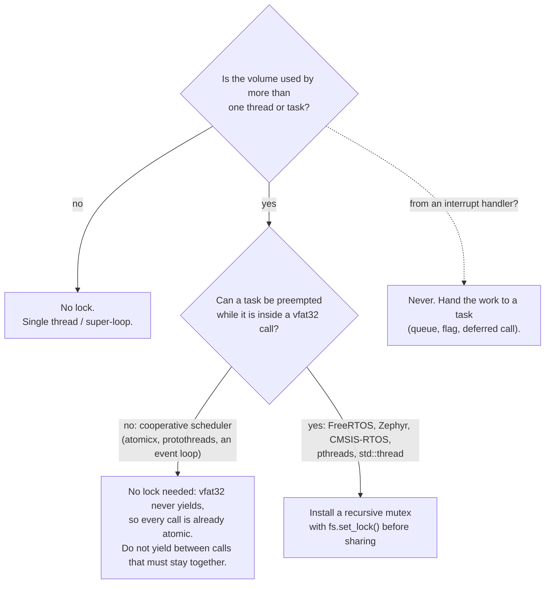

### 9.3 The contract

| Rule | Why |
|---|---|
| **The lock must be recursive** (the owner may lock it again). | `flockfile` holds it while your calls inside the group lock it again (T3). A non-recursive mutex deadlocks there. |
| **Call `set_lock` before the volume is shared**, and not while other threads use it. | `set_lock` itself is not locked (T1). |
| **Never call vfat32 from an interrupt handler.** | A mutex cannot be taken there, and calls may take long (T5). |
| **The clock callback must not call vfat32.** | It runs with the lock held (T7). |
| **Every member** except `set_lock`, `set_clock`, `needs_format` (static) and `strerror` (static) takes the lock on entry and releases it on every return path (T2). | |
| `flockfile`/`funlockfile` lock **the whole volume**, not one stream. | Stronger than POSIX's per-stream lock, so still correct. |

The interface is:

```cpp
class lock_interface {
public:
    virtual void lock() = 0;
    virtual void unlock() = 0;
protected:
    ~lock_interface() {}
};
```

### 9.4 Ready-made locks

**POSIX threads (Linux, macOS)** — the one used by [`examples/pc/threads.cpp`](examples/pc/threads.cpp) and the
threads test:

```cpp
#include <pthread.h>
class pthread_lock : public vfat32::lock_interface {
public:
    pthread_lock() {
        pthread_mutexattr_t a;
        pthread_mutexattr_init(&a);
        pthread_mutexattr_settype(&a, PTHREAD_MUTEX_RECURSIVE);   // recursive: required
        pthread_mutex_init(&m_, &a);
        pthread_mutexattr_destroy(&a);
    }
    ~pthread_lock() { pthread_mutex_destroy(&m_); }
    void lock() override { pthread_mutex_lock(&m_); }
    void unlock() override { pthread_mutex_unlock(&m_); }
private:
    pthread_mutex_t m_;
};
```

**C++11 standard library (PC)** — vfat32 itself uses no STL, but your application may:

```cpp
#include <mutex>
class std_lock : public vfat32::lock_interface {
public:
    void lock() override { m_.lock(); }
    void unlock() override { m_.unlock(); }
private:
    std::recursive_mutex m_;
};
```

**FreeRTOS (and ESP32 Arduino, which runs on FreeRTOS)** — needs `configUSE_RECURSIVE_MUTEXES 1`; FreeRTOS mutexes
have priority inheritance:

```cpp
#include "freertos/FreeRTOS.h"   // ESP-IDF / Arduino-ESP32 paths; plain FreeRTOS: "FreeRTOS.h"
#include "freertos/semphr.h"
class freertos_lock : public vfat32::lock_interface {
public:
    freertos_lock() : m_(xSemaphoreCreateRecursiveMutex()) {}
    void lock() override { xSemaphoreTakeRecursive(m_, portMAX_DELAY); }
    void unlock() override { xSemaphoreGiveRecursive(m_); }
private:
    SemaphoreHandle_t m_;
};
```

**Zephyr** — `k_mutex` is recursive and has priority inheritance:

```cpp
#include <zephyr/kernel.h>
class zephyr_lock : public vfat32::lock_interface {
public:
    zephyr_lock() { k_mutex_init(&m_); }
    void lock() override { k_mutex_lock(&m_, K_FOREVER); }
    void unlock() override { k_mutex_unlock(&m_); }
private:
    struct k_mutex m_;
};
```

**CMSIS-RTOS2 (STM32Cube, Keil RTX)**:

```cpp
#include "cmsis_os2.h"
class cmsis_lock : public vfat32::lock_interface {
public:
    cmsis_lock() {
        const osMutexAttr_t attr = {"vfat32", osMutexRecursive | osMutexPrioInherit, nullptr, 0U};
        m_ = osMutexNew(&attr);
    }
    void lock() override { osMutexAcquire(m_, osWaitForever); }
    void unlock() override { osMutexRelease(m_); }
private:
    osMutexId_t m_;
};
```

**Cooperative schedulers** (atomicx, protothreads, an event loop): no lock. A switch only happens when the running
task yields, and vfat32 never yields inside a call. Keep the calls that must stay together free of yields.

Install it once, before the volume is shared:

```cpp
static pthread_lock volume_lock;      // must outlive every use of fs
fs.set_lock(&volume_lock);
```

### 9.5 Atomic groups: flockfile / funlockfile

Each call is atomic, but a **sequence** of calls is not: another thread may run between them. Wrap a sequence that
must not be interleaved:

```cpp
fs.flockfile(log);                         // nobody else enters vfat32 until funlockfile
fs.fputs("BEGIN record 42\n", log);
fs.fprintf(log, "temperature=%d\n", t);
fs.fputs("END\n", log);
fs.fflush(log);
fs.funlockfile(log);
```

Without the group, two threads appending records to one file can interleave their lines; with it, each record is
contiguous ([`threads.cpp`](examples/pc/threads.cpp): 4 threads × 500 two-line records, every record intact; the
threads test does the same under ThreadSanitizer).

### 9.6 Errors in threaded code

`last_error()` belongs to the volume, not to the thread (T4): between your failed call and your `last_error()`, another
thread's call may fail and overwrite it. When that matters, read it inside the same group:

```cpp
fs.flockfile(nullptr);
vfat32::file* f = fs.fopen(path, "r");
vfat32::error why = f ? vfat32::error::none : fs.last_error();
fs.funlockfile(nullptr);
```

A stream's own `ferror(f)`/`feof(f)` flags are per handle and need no group.

### 9.7 Sharing handles between threads

- A handle may be used by several threads: each call is atomic. But they share its **position** and buffer, so the
  usual pattern is **one handle per thread** (open the same file twice if needed: handles on one file stay coherent,
  §6.3).
- **Closing a handle while another thread still uses it is your bug** (T6): vfat32 validates handles, so a closed
  handle fails with `error::bad_handle` — but if a third thread opens a file meanwhile, the row may be reused and the
  stale pointer then refers to that new file. Decide which thread owns each handle and closes it.
- `umount()` closes every handle (D6); stop the other threads first.

### 9.8 Long calls and latency

The lock is held for the whole call. Most calls are short (microseconds), but some are proportional to the volume:

| Call | Holds the lock for | How to bound it |
|---|---|---|
| `fwrite`/`write` of N bytes | the copy of N bytes | write in chunks |
| `check()` | one pass over the FAT and the tree (< 1 ms for 129k clusters, measured) | — |
| `defrag()` | all moves | `defrag(max_moves)` in a loop, releasing the lock between steps (§11) |
| `format()`, `mount()` | zeroing the FATs / one FAT pass | do it at start-up |

```cpp
while (fs.defrag(256) == 1) {   // 256 moves per step: other tasks get the volume in between
    vTaskDelay(1);              // or yield, or just loop
}
```

### 9.9 Priority inversion and deadlocks

- On an RTOS use a **mutex with priority inheritance** (FreeRTOS mutexes, Zephyr `k_mutex`, CMSIS `osMutexPrioInherit`),
  not a binary semaphore: a low-priority task holding the volume is then boosted while a high-priority task waits.
- Deadlocks can only come from **your** other locks. Rules: never wait inside a `flockfile` group for something
  another thread can only produce by calling vfat32; if you also hold your own mutex, always take the two in the same
  order in every thread.
- Two volumes are independent objects: give each its own lock (or the same recursive one).

### 9.10 Testing your setup

- `make test_tsan` runs the threads test under ThreadSanitizer: four threads hammering one volume through the lock,
  with `flockfile` groups — it must report no data race.
- [`examples/pc/threads.cpp`](examples/pc/threads.cpp) is a template for your own stress test.

### 9.11 Checklist

- [ ] One recursive mutex per volume (or none for single-thread / cooperative use).
- [ ] `fs.set_lock(&lock)` before starting the threads; the lock object outlives `fs`.
- [ ] Never from an interrupt handler; the clock callback never calls vfat32.
- [ ] Multi-call sequences in `flockfile`/`funlockfile`; `last_error()` read inside them when it matters.
- [ ] One owner per handle; closes happen after every user is done.
- [ ] `defrag(max_moves)` in steps where latency matters.
- [ ] RTOS: a mutex with priority inheritance.

---

## 10. Integrity check and repair

`check(&report, repair)` walks every directory and every chain and compares them with the FAT (spec §11):

| Counter | Finding | Repair |
|---|---|---|
| `lost_clusters` | allocated, owned by nobody (e.g. after a reset mid-write) | freed (only when every directory was walked) |
| `cross_links` | a cluster used by two chains, or a loop | the second chain is cut |
| `bad_chains` | a link out of range, into free or bad space | the chain is cut before it |
| `size_errors` | file size ≠ its clusters; a directory with a size | size or chain made to agree |
| `bad_entries` | a directory without a valid cluster; wrong `.`/`..` | `.`/`..` rewritten; empty entries removed |
| `fat_mismatches` | the two FAT copies differ | second copy rewritten from the first |
| `fsinfo_errors` | FSInfo's free count is wrong | rewritten |
| `reserved_bits` | FAT entries with their reserved upper bits set | cleared |

It also reports `files`, `directories` (without the root), `used_clusters`, `free_clusters`, `bad_clusters`,
`free_extents` (runs of free clusters) and `fragmented` (chains that are not one run — a hint for `defrag`).

```cpp
vfat32::check_report r;
if (fs.check(&r) != 0)                          // read-only; handles may be open
    printf("%u errors\n", r.errors());
if (fs.check(&r, true) == 0)                     // repair; needs every handle closed
    printf("clean after %u repairs\n", r.repaired);
```

`check` returns 0 when the volume is clean (with `repair`, when it is clean **after** repairing: a second pass
decides). It needs no RAM: while it runs, bit 31 of each FAT entry — a reserved bit — marks "reached", and every mark
is cleared before it returns (D3). The directory tree is walked without a stack, going back up through each
directory's `..` entry, so any depth works on any MCU.

---

## 11. Defragmentation

After many writes and deletes, files are scattered and free space is split into holes. `defrag()` moves clusters so
that **every file and directory is one run of consecutive clusters**, laid out in tree order, and **all free space is
one run at the end**. Both pictures below are drawn by `make docs` from a real volume, before and after `defrag()`:

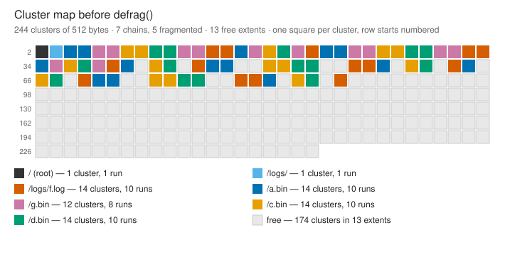

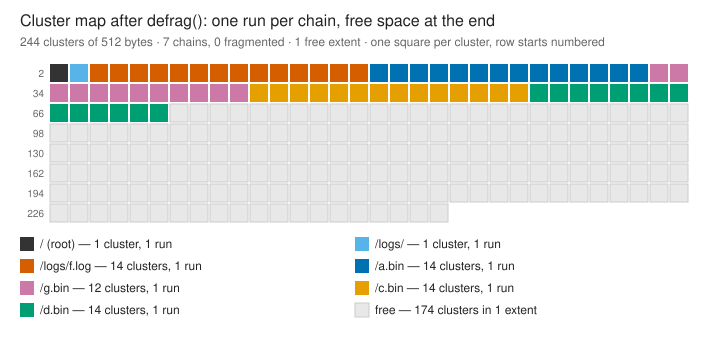

How it works, in place and without a buffer (spec §12):

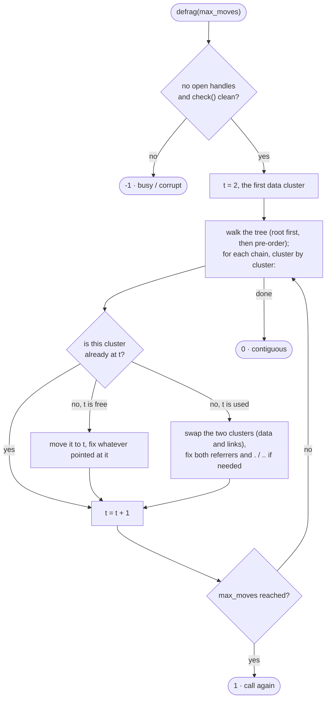

- **Incremental**: `defrag(max_moves)` stops after that many moves and returns 1; call it again until it returns 0.
  Nothing is kept between calls (each starts from the beginning and skips what is already in place), the volume is
  consistent between them, and other calls — even writes — may run in between (D4).
- **Preconditions**: no open file or directory (`error::busy`) and a clean `check()` (`error::corrupt`).
- **Cost** (measured, Apple M-series, `-O2`):

| Volume | Used clusters | Fragmented chains | `defrag()` total | Per 1000-move step |
|---|---|---|---|---|
| 1 MiB | 294 | 28 | < 1 ms | — |
| 8 MiB | 1,900 | 135 | 7 ms | ≈ 4 ms |
| 64 MiB | 18,836 | 668 | 0.20 s | ≈ 11 ms |
| 64 MiB | 68,786 | 668 | 1.5 s | ≈ 22 ms |

Each move that lands on an occupied cluster scans the FAT for the occupant's predecessor, so the worst case is
O(N²) in the number of clusters; MCU volumes have a few thousand clusters at most. **Not power-fail safe** on
retained RAM: a reset in the middle of a swap can leave it half done — run `check(&r, true)` after such a reset.

---

## 12. Images and interoperability

The volume is a FAT32 image. Save it, check it, mount it:

```cpp
fs.umount();                                       // sets the clean bit: always save after umount
FILE* out = fopen("volume.img", "wb");
fwrite(ram, 1, sizeof ram, out);
fclose(out);
```

```sh
fsck_msdos -n volume.img                 # macOS
fsck.fat -n volume.img                   # Linux (dosfstools)
mdir -i volume.img ::/                   # mtools
sudo mount -o loop volume.img /mnt       # Linux
hdiutil attach -imagekey diskimage-class=CRawDiskImage volume.img   # macOS
```

And the other way round: format an image on the PC (`newfs_msdos -F 32`, `mkfs.fat -F 32`), load it into memory,
`mount(reuse)`.

Verified: images made by vfat32 pass macOS `fsck_msdos -n` (exit 0) — a 40 MiB volume with 80,606 clusters (FAT32
by every rule) and also 64 KiB and 1 MiB volumes with long and UTF-8 names (relaxed layout, decision G1). The test
suite repeats this on every run where the host tool exists (§15).

**Small volumes and Windows.** Microsoft's rule calls a volume FAT32 only from 65,525 clusters (≈ 33 MiB with 512-byte
clusters). vfat32 always writes FAT32 structures (spec G1): Linux, macOS and mtools recognise FAT32 by those
structures and mount small images; Windows decides by cluster count and will not. For Windows-mountable images use
≥ 33 MiB of memory (or larger clusters with more memory).

---

## 13. Microcontrollers

### 13.1 Memory budget

RAM = the volume + the `vfs` object (§3.4) + stack. The stack peak is small: the largest local buffer is `fprintf`'s
`VFAT32_PRINTF_MAX` bytes; everything else is a few dozen bytes (names are kept in the `vfs` object, not on the
stack; `check` and `defrag` use no tables).

On AVR the defaults are already reduced (2 files, 1 directory, 32-byte buffers and names, 64-byte `fprintf`). The
Arduino IDE cannot pass `-D` per sketch; put other values in `platform.local.txt` next to the core's
`platform.txt`:

```
compiler.cpp.extra_flags=-DVFAT32_MAX_OPEN_FILES=4 -DVFAT32_BUFFER_SIZE=64
```

### 13.2 Measured sizes

| Target | Flash | RAM |
|---|---|---|
| AVR ATmega2560, whole API in a test program, `-Os`, `--gc-sections` (`make check_embedded`) | 38,928 B (incl. avr-libc's `vsnprintf`) | 383 B `vfs` + 4,096 B volume |
| Arduino Mega 2560, `vfat32_basic` sketch (`make arduino_check`) | 26,152 B | 5,349 B incl. a 4 KiB volume |
| ESP32, the library objects, `-Os` | 25,568 B | 6,668 B `vfs` with defaults |
| ESP32, `vfat32_basic` sketch with the Arduino core | 296,920 B | 94,276 B incl. a 64 KiB volume |

An AVR with 2 KiB of RAM (Uno, Nano) cannot hold a volume (the minimum is 3 KiB); a Mega 2560 (8 KiB) or an ATmega1284
(16 KiB) can.

### 13.3 Portability rules the code follows

- C++11 with only `<stddef.h>`, `<stdint.h>`, `<string.h>`, `<stdarg.h>`, `<stdio.h>` (`vsnprintf`) and, with
  `VFAT32_USE_HEAP=1`, `<stdlib.h>` — present in avr-libc, newlib and glibc.
- No exceptions, no RTTI, no `new`, no STL, no static or global state (any number of volumes).
- Every on-disk field is read and written byte by byte, little-endian: no alignment requirement on your memory (no
  faults on Cortex-M0), correct on big-endian CPUs.
- `make check_embedded` proves, with `VFAT32_USE_HEAP=0`, that no heap, exception or RTTI symbol is referenced; the
  library's only external symbols are `memcpy`, `memset`, `memcmp`, `memchr`, `strlen` and `vsnprintf`.
- `lock_interface` is the only class with virtual functions. A bare-metal toolchain without a C++ runtime may need
  `extern "C" void __cxa_pure_virtual() { for (;;) {} }` (Arduino, ESP-IDF, Zephyr and mbed provide it).
- avr-libc defines `feof(s)`/`ferror(s)` as macros; `vfat32.hpp` includes `<stdio.h>` and removes them (avr-libc
  also has the real functions, so C code keeps working).

### 13.4 A volume that survives resets

Put the volume in RAM the startup code does not clear and mount it with `format_if_needed`: after a reset it is
reused, and `was_dirty()` tells whether the previous run was interrupted while mounted. See
[`vfat32_retained_ram.ino`](examples/arduino/vfat32_retained_ram/vfat32_retained_ram.ino):

```cpp
__NOINIT_ATTR static uint8_t ram[32 * 1024];   // ESP32: survives software and watchdog resets
// GCC elsewhere: __attribute__((section(".noinit"))) — check your linker script keeps .noinit
fs.mount(ram, sizeof ram, vfat32::mount_mode::format_if_needed);
if (fs.was_dirty()) { vfat32::check_report r; fs.check(&r, true); }
```

---

## 14. API reference

All members of `vfat32::vfs`. Unless noted, functions behave as their C/POSIX namesakes, return `-1`/`NULL`/`EOF` on
failure and set `last_error()` (§8).

### 14.1 Volume

| Member | Returns | Notes |
|---|---|---|
| `static bool needs_format(const void* mem, size_t size)` | `true` unless a complete FAT32 is there | §5.1; no lock; read-only |
| `int mount(void* mem, size_t size, mount_mode mode, const format_options* o = nullptr)` | 0 / -1 | §5; `busy` if mounted |
| `int mount(size_t size, const format_options* o = nullptr)` | 0 / -1 | `calloc` + format; freed by `umount` (`VFAT32_USE_HEAP`) |
| `int umount()` | 0 / -1 | flushes and closes every handle; -1 if a flush failed (still unmounted) |
| `int format(const format_options* o = nullptr)` | 0 / -1 | re-format the mounted volume; `busy` with open handles |
| `bool mounted() const` | | |
| `bool was_dirty() const` | | the volume was not cleanly unmounted before this mount |
| `int sync()` | 0 / -1 | flush all streams, write pending times and FSInfo |
| `int statvfs(struct statvfs* buf)` | 0 / -1 | `f_bsize`, `f_frsize`, `f_blocks`, `f_bfree`, `f_bavail`, `f_namemax` |
| `int check(check_report* r, bool repair = false)` | 0 clean / -1 | §10 |
| `int defrag(uint32_t max_moves = 0)` | 0 done / 1 more / -1 | §11 |

### 14.2 Errors and hooks

| Member | Notes |
|---|---|
| `error last_error() const` | last failure on this volume (§8, §9.6) |
| `static const char* strerror(error e)` | English text |
| `void set_lock(lock_interface* l)` | §9; `nullptr` removes it |
| `void set_clock(clock_function f)` | `timestamp (*)()`, called with the lock held |
| `void flockfile(file* f)` / `void funlockfile(file* f)` | lock / unlock the whole volume (§9.5); `f` may be `nullptr` |

### 14.3 Streams (buffered)

| Member | Notes |
|---|---|
| `file* fopen(const char* path, const char* mode)` | modes §6.1 |
| `int fclose(file* f)` | flushes; frees the handle even if the flush fails (then `EOF`) |
| `size_t fread(void* p, size_t size, size_t n, file* f)` | sets `feof` at the end |
| `size_t fwrite(const void* p, size_t size, size_t n, file* f)` | short count when the volume fills |
| `int fgetc(file* f)` / `int fputc(int c, file* f)` | |
| `int ungetc(int c, file* f)` | one character |
| `char* fgets(char* s, int n, file* f)` | |
| `int fputs(const char* s, file* f)` | 0 on success |
| `int fprintf(file* f, const char* fmt, ...)` / `int vfprintf(file*, const char*, va_list)` | at most `VFAT32_PRINTF_MAX - 1` bytes per call |
| `int fseek(file* f, long off, int whence)` / `long ftell(file* f)` / `void rewind(file* f)` | `seek_set`, `seek_cur`, `seek_end` |
| `int fgetpos(file* f, fpos_t* p)` / `int fsetpos(file* f, const fpos_t* p)` | full 32-bit range |
| `int fflush(file* f)` | `nullptr` flushes every stream |
| `int feof(file* f)` / `int ferror(file* f)` / `void clearerr(file* f)` | |
| `int setvbuf(file* f, char* buf, int mode, size_t size)` | `io_fbf`, `io_lbf`, `io_nbf`; any time |
| `void setbuf(file* f, char* buf)` | `buf` of `vfat32::bufsiz` bytes, or `nullptr` for unbuffered |
| `int fileno(file* f)` | the handle's descriptor |

### 14.4 Descriptors (unbuffered)

| Member | Notes |
|---|---|
| `int open(const char* path, int flags)` | `o_rdonly`/`o_wronly`/`o_rdwr` + `o_creat`, `o_excl`, `o_trunc`, `o_append` |
| `int close(int fd)` | |
| `long read(int fd, void* buf, size_t n)` / `long write(int fd, const void* buf, size_t n)` | 0 at end of file |
| `long lseek(int fd, long off, int whence)` | seeking past the end and writing zero-fills the gap |
| `int fsync(int fd)` | writes pending data and times |
| `int ftruncate(int fd, long length)` | grow with zeros or shrink |
| `int fstat(int fd, struct stat* buf)` | |

### 14.5 Paths and directories

| Member | Notes |
|---|---|
| `int stat(const char* path, struct stat* buf)` | §7.4 |
| `int mkdir(const char* path)` / `int rmdir(const char* path)` | |
| `int remove(const char* path)` / `int unlink(const char* path)` | open files: `busy` |
| `int rename(const char* old_path, const char* new_path)` | §7.3 |
| `int truncate(const char* path, long length)` | |
| `dir* opendir(const char* path)` / `dirent* readdir(dir* d)` / `void rewinddir(dir* d)` / `int closedir(dir* d)` | `dirent`: `d_name` (UTF-8), `d_type` (`dt_dir`/`dt_reg`), `d_size` |

### 14.6 Types and constants

| Name | Meaning |
|---|---|
| `vfat32::file`, `vfat32::dir` | opaque handle rows |
| `vfat32::dirent`, `vfat32::stat`, `vfat32::statvfs`, `vfat32::fpos_t` | as above |
| `vfat32::timestamp` | `{year, month, day, hour, minute, second}` |
| `vfat32::format_options`, `vfat32::check_report` | §5.2, §10 |
| `vfat32::mount_mode` | `reuse`, `format`, `format_if_needed` |
| `vfat32::error` | §8 |
| `eof`, `seek_*`, `io_*`, `bufsiz`, `o_*`, `s_ifdir`, `s_ifreg`, `s_isdir()`, `s_isreg()`, `dt_*`, `attr_*` | C/POSIX equivalents with vfat32 names |

---

## 15. Testing

```sh
make test          # 138 tests, about 1.6 s
make test_long     # the random stress test: 64 seeds × 20,000 operations
make test_asan     # under AddressSanitizer + UndefinedBehaviorSanitizer
make test_tsan     # threads under ThreadSanitizer
make check_embedded arduino_check
```

| Suite | What it proves |
|---|---|
| volume | probe rules P1–P12 one by one; formats of many sizes and options; BPB and FSInfo bytes; reuse; the clean bit |
| streams, descriptors | every mode, buffering mode and edge case of §7 against the C semantics |
| handles | many handles on one file, coherence, truncation through one handle, exhaustion, invalid handles |
| directories, names, rename | §6–§8, long and UTF-8 names, 8.3 aliases (raw slots checked), POSIX `rename` |
| space | a full volume, short writes, space coming back |
| check | damage injected in the raw bytes (lost cluster, cross-link, broken size, FAT mismatch, `..`, FSInfo, reserved bits) is found and repaired |
| defrag | fragmented trees defragmented fully and step by step; contents identical; volume clean after every step |
| random | a model-based stress test: random operations checked against a reference model, `check()` and remounts along the way |
| threads | four threads through the lock, `flockfile` groups, no lost or interleaved record |
| external | images checked by the host's `fsck_msdos`/`fsck.fat`; an image formatted by the host used with `reuse` |

The random draws come from a portable xorshift generator, so a seed gives the same run on every system.

Results (2026-10-28, spec §15.2): `make test` 138 of 138; `make test_asan` 138 of 138 with no report;
`make test_tsan` no data race; `make test_long` passes; `check_embedded` and `arduino_check` pass. Each defect the
tests found got a test that fails before the fix and passes after (spec changelog).

---

## 16. Limits and open problems

- Volumes under 65,525 clusters are FAT32 by layout, not by Microsoft's rule: Windows will not mount them (§12).
- Case-insensitive matching covers ASCII letters only; 8.3 aliases use ASCII (non-ASCII characters become `_`).
- `defrag` is O(N²) in the worst case and not power-fail safe on retained RAM.
- Directories never shrink: deleted slots are reused, not released.
- No `chmod`, `utime`, `chdir`, `mmap`, file locking or permissions.
- `fprintf` output is limited to `VFAT32_PRINTF_MAX - 1` bytes per call.

---

## 17. License

MIT — Copyright (c) 2026 Gustavo Campos. See [LICENSE](LICENSE).
