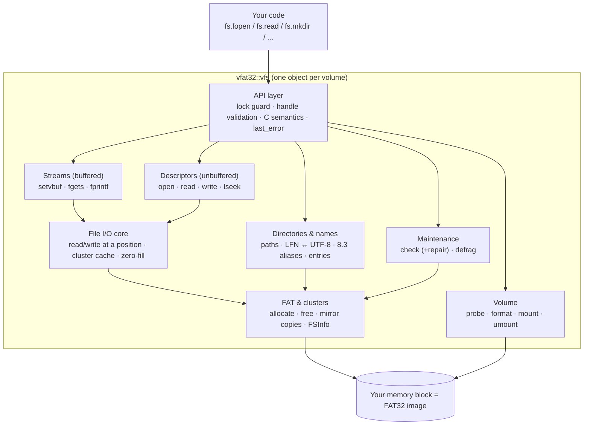
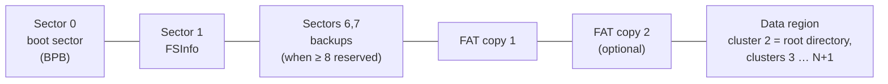
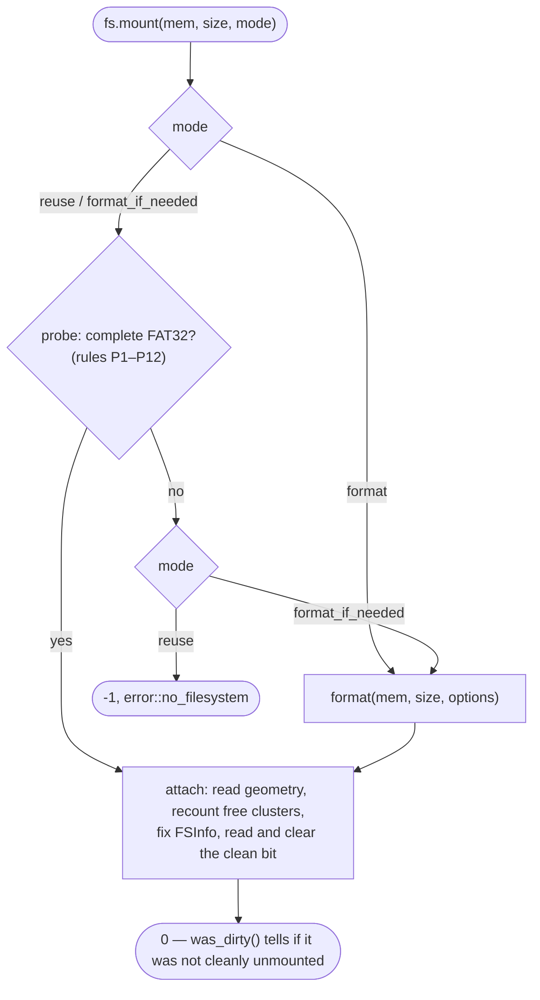
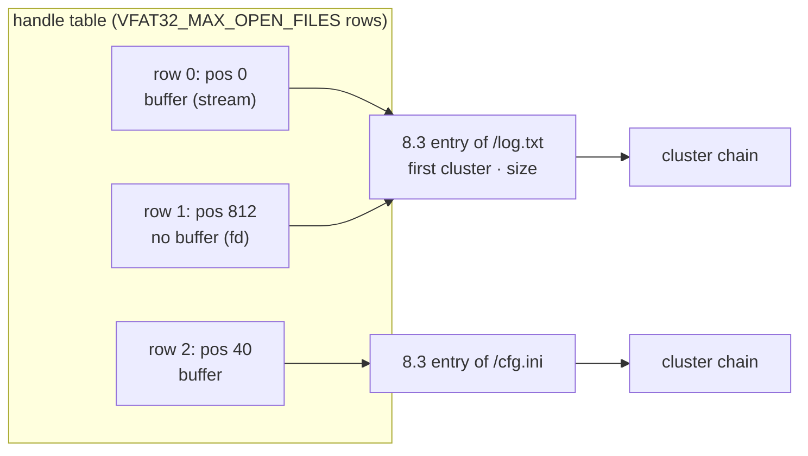
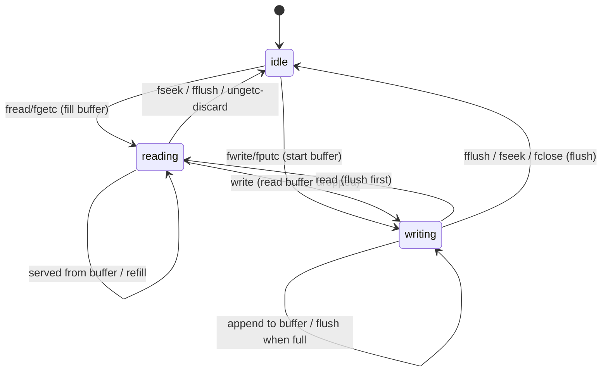
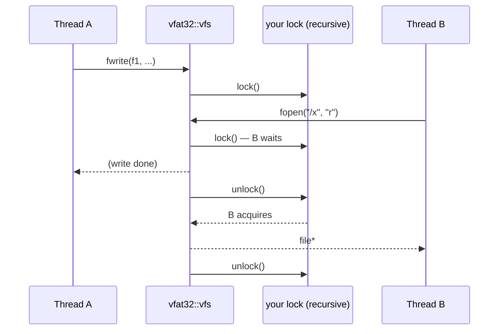
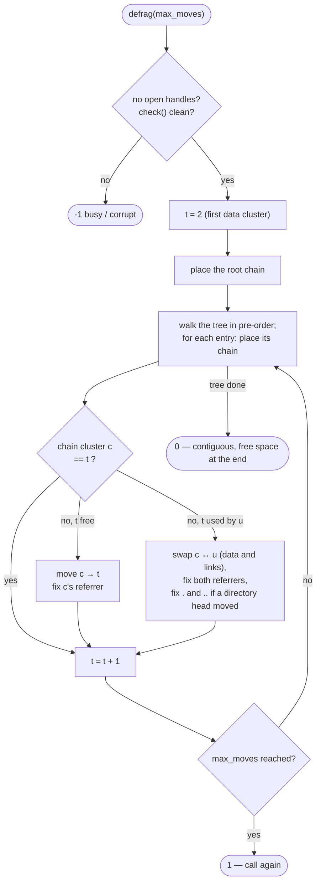

# vfat32 — Specification (SDD), v1.0

**What vfat32 is.** vfat32 is a file system that lives entirely in RAM. You give it a block of memory (or let it
`calloc` one) and it turns that memory into a real **FAT32 volume**: the same bytes a USB stick formatted by a PC
would hold. On top of it you get the functions every C programmer already knows — `fopen`, `fread`, `fwrite`,
`fgets`, `fprintf`, `fseek`, `open`, `read`, `write`, `lseek`, `mkdir`, `opendir`, `readdir`, `rename`, `remove`,
`stat` — as members of one object, `vfat32::vfs`. Because the memory *is* a FAT32 image, it can be saved to a file
and checked or mounted by Linux or macOS, and an image made elsewhere can be loaded and used.

It is written in plain C++11 with no standard template library, no exceptions, no RTTI and no heap (except the
optional `calloc` of the volume itself), so the same code runs on a PC and on a microcontroller (ESP32, STM32,
AVR with enough RAM).

This file is normative: every change to behaviour, API, layout or tests is recorded here first (Spec-Driven
Development). Where this file and the code disagree, the disagreement is a defect to be resolved here first.

**Repository:** github.com/solariun/vfat32 (public), MIT license, Copyright (c) 2026 Gustavo Campos.

**Status (2026-10-28):** v1.0 specified, built and measured (§15.2): 138 tests pass (also under ASan/UBSan and, for
the threads tests, TSan); the long stress run passes; images pass macOS `fsck_msdos`; AVR and ESP32 builds pass
`check_embedded` and `arduino_check`.

### Changelog

| Date | Change |
|---|---|
| 2026-10-28 | v1.0 specified from Gustavo's request: in-memory FAT32, C++11 without STL, MCU-ready, memory external or `calloc`, buffered and unbuffered I/O, many open files, a developer-supplied lock with a complete manual section, format / reuse / "needs format?" at start-up, defragmentation, C standard names, tests, full documentation. Decisions G1–G4 taken by Gustavo (§2.1). |
| 2026-10-28 | v1.0 built: library (`src/`), tests, examples, figures, README manual; measured numbers in §15.2. |
| 2026-10-28 | Portability fixes found by building the examples for ESP32 and AVR (D16, K6): the `stat` time fields renamed `st_modified`, `st_created`, `st_accessed` (`st_mtime` and friends are macros in macOS, glibc and newlib); `vfat32.hpp` removes avr-libc's `feof(s)`/`ferror(s)` macros; AVR gets smaller defaults (§13). |
| 2026-10-28 | Defects found by the tests and fixed: `check()` without repair cleared a pre-existing bit 31 when it had skipped the walk (it must change nothing, C1/C4; found by `check_reserved_bits_c1`); a subdirectory that could not be entered stopped the whole read-only walk, so later entries were not verified (C2; `check_walk_continues_after_bad_subdir_c2` fails before, passes after). Rules made explicit where the test writer had to choose: N5 (no tail when only the case differs), the size repair of §11.1, the error codes of §9. |
| 2026-10-28 | First Linux CI run (g++ 13, glibc, `-O2`): two warnings clang and the cross compilers had not raised — `-Wtype-limits` on the `long` overflow checks of B8 where `long` is 64 bits (now decided at preprocessing time: `fits_long`), and `-Warray-bounds` on `create_entry`'s write through a slot pointer that is null only at a chain's end (now checked, `corrupt`) — plus `-Wformat-truncation` in the external test. `check_embedded` gained a GCC `-O2 -D_FORTIFY_SOURCE=2` build (ESP32 GCC 14) that reproduces this class of warning locally. A sweep of every source, test, example and tool with GCC 14 at `-O1`, `-O2`, `-O3`, `-Os` with fortify then found the rest (`-O3`'s may-be-uninitialised out-parameters, more `snprintf` truncation checks); every scalar local in `src/` is now initialised. |

### How to read this document

- Every section starts **in plain words**, often with a picture; **exact rules** follow (constants, byte offsets,
  algorithms) for implementers.
- Rules are numbered (`F3`, `S7`, …) so tests and code comments can point at them.
- Every term is in the glossary (§17).

---

## 1. Requirements

In plain words: what Gustavo asked for, one line each, and where each one is answered.

| # | Requirement (Gustavo, 2026-10-28) | Answered in |
|---|---|---|
| R1 | A virtual file system in memory that holds a FAT32 | §4, §5 |
| R2 | Entirely C++11, standard C++11, no STL | §14 |
| R3 | Ready to be used on MCUs | §13, §14 |
| R4 | The volume memory provided externally or created with `calloc` | §5.2 |
| R5 | Read, write, directory handling | §7, §8 |
| R6 | Buffered I/O and unbuffered I/O | §7.3, §7.4 |
| R7 | Many files open at once | §7.1 |
| R8 | Thread safety is the developer's job, but with an extra mechanism for it, and a complete README section | §10, README "Thread safety" |
| R9 | At start-up: format or reuse; a way to check whether the memory needs formatting — "if a complete FAT32 is there, say no" | §5.1, §5.2 |
| R10 | A defragmentation option | §12 |
| R11 | Member names are the standard C (and POSIX) names | §7, §8 (API table §16) |
| R12 | Production-ready code, best practices, documentation, sample code, integrity tests, full documentation | §15, README, `examples/`, `tests/` |
| R13 | Project named vfat32, created on Gustavo's GitHub and pushed once everything passes | §15.4 |

---

## 2. Decisions

### 2.1 Gustavo's decisions (2026-10-28)

| # | Decision | Reason | Rejected alternative |
|---|---|---|---|
| G1 | **Relaxed FAT32 layout.** Every volume uses the FAT32 structures (BPB with the FAT32 fields, FSInfo, 32-bit FAT, root directory in a cluster chain); small volumes simply have fewer clusters than the Microsoft minimum (65,525). | The Microsoft minimum means ≥ ~33 MB with 512-byte clusters: no MCU has that much RAM. Linux, macOS (BSD `msdosfs`) and mtools decide "FAT32" from the BPB (`FATSz16 == 0`, `RootEntCnt == 0`), not from the cluster count, so small images still mount there. | Strict spec only (refuse below 65,525 clusters): Windows-compatible everywhere but unusable on MCUs. |
| G2 | **Long file names (VFAT/LFN), UTF-8 in the API.** | Real-world names; interoperability with images from PCs. `VFAT32_NAME_MAX` shrinks the RAM it costs. | 8.3 names only. |
| G3 | **Two API families on one handle table: stdio streams (buffered) and POSIX descriptors (unbuffered)**, C semantics (`NULL`/`-1` plus `last_error()`), and a **developer-supplied recursive lock object** (`vfat32::lock_interface`). | Matches what "buffered" and "unbuffered" mean to a C programmer (`fopen`/`fread` vs `open`/`read`). One table keeps the cost of two families small. | stdio only (unbuffered only through `setvbuf(_IONBF)`); C-style lock callbacks. |
| G4 | **Public repository `solariun/vfat32`.** | Same as Gustavo's other projects. | Private. |

### 2.2 Design decisions

| # | Decision | Reason | Rejected alternatives |
|---|---|---|---|
| D1 | **The directory entry is the file's only metadata record.** An open handle stores the byte offset of its 8.3 entry; size and first cluster are read from and written to that entry directly, at once. | All of it is RAM: reading 4 bytes from the entry costs nothing. Every handle on the same file sees the same size and chain without a shared "node" table, and the image in memory is a consistent FAT32 at every moment (D2). | A vnode table with cached size (needs synchronisation between handles and a flush step). |
| D2 | **The image is always consistent between calls.** Size, first cluster, FAT (all copies) and FSInfo are updated inside the call that changes them; only stream write buffers (§7.3) and the modification time (written at `fflush`/`fsync`/`fclose`, D9) wait. | A snapshot taken at any moment (an MCU reset with retained RAM, a test dumping the image) is a valid FAT32. | Write-back caching of metadata. |
| D3 | **Integrity check and defragmentation use O(1) RAM.** While they run, bit 31 of the entries of the first FAT (a reserved bit) marks "cluster reached"; all marks are cleared before the call returns. Directory trees are walked without a stack, through the `..` entries (§11.2). | MCUs: a bitmap of the clusters or a recursion stack does not fit. FAT32's upper 4 bits are reserved and zero on every formatter we know; a volume where they are not zero is reported (§11). | A cluster bitmap from the heap; a fixed-depth stack (would cap the directory depth). |
| D4 | **Defragmentation is in place, needs no free space and no buffer, and is incremental**: `defrag(max_moves)` does at most `max_moves` cluster moves and returns whether more work remains; each call starts again from the beginning, so nothing is kept between calls and the volume is consistent between them (§12). | Bounded lock hold time and watchdog-friendly on MCUs; other calls (even writes) may run between two steps. | One long non-interruptible pass; a copy-to-free-space defragmenter (fails on a full volume). |
| D5 | **Read buffers are coherent, write buffers are private.** A write through any handle discards the read buffers of the other handles on the same file; a stream's write buffer is visible to other handles only after it is flushed (as in stdio). | Cheap in RAM (a scan of the handle table); readers never see stale data that was already written. | Pure stdio semantics (stale read buffers); write-through only (no buffering). |
| D6 | **`umount()` flushes and closes every open handle** (as `exit()` does with streams) and reports a failed flush. Handles used afterwards fail with `error::bad_handle`. | Simple shutdown on MCUs; handles are validated on every call (§7.1), so a late use cannot crash. | `EBUSY` while files are open (Linux `umount`). |
| D7 | **POSIX `rename`**: an existing target file is replaced; a target directory must be empty; a directory cannot be moved into its own subtree; open files may be renamed (their handles follow); an open target cannot be replaced (`error::busy`). | What C programmers on Linux/macOS expect. | DOS semantics (fail if the target exists). |
| D8 | **An open file cannot be removed** (`error::busy`); an open directory cannot be removed. | FAT has no inode to keep alive without its directory entry. | POSIX "unlink while open". |
| D9 | **Modification time is set when a modified handle is flushed, synced or closed**, from the developer's clock (§4.8). | The clock may be slow (an RTC on I²C): once per close, not once per write. | A time stamp on every write. |
| D10 | **The read-only attribute blocks opening for writing** (`error::access`); `remove` and `rename` are allowed (Linux `vfat` semantics). | No `chmod` is needed to clean up a foreign image. | Windows semantics (read-only files cannot be deleted). |
| D11 | **`readdir` does not return `.` and `..`**, in any directory. The volume label entry is never returned. | The root has no `.`/`..` on FAT; filtering them everywhere gives one behaviour (FatFs does the same). | Synthesising `.`/`..` for the root (Linux). |
| D12 | **Paths are absolute from the root**, separator `/`; a leading `/` is optional; `.` and `..` components work; there is no current directory. | No hidden per-volume state shared between threads. | `chdir`/`getcwd`. |
| D13 | **Case-insensitive names, ASCII folding only** (`a`–`z` ↔ `A`–`Z`); other characters compare exactly. 8.3 aliases use ASCII as the OEM code page; a non-ASCII byte in an 8.3-only entry from a foreign image is shown as `_`. | No Unicode case tables or code pages in MCU flash. | Full Unicode up-case table (≈ 2.5 KB of flash). |
| D14 | **`fprintf`/`vfprintf` format into a stack buffer of `VFAT32_PRINTF_MAX` bytes**; a call whose output does not fit fails (`error::invalid`) and writes nothing. | Predictable stack use on MCUs; never silent truncation. | Heap-allocated formatting buffers; truncating. |
| D15 | **Errors follow C**: functions return `NULL`, `-1` or `EOF` and set the volume's `last_error()`; a successful call does not clear it. Streams also keep their own `ferror`/`feof` flags. Error values are `vfat32::error`, not `errno`. | C semantics for C names; `<errno.h>` on avr-libc has only `EDOM`/`ERANGE`, so host `errno` values are not portable. | Returning negative error codes (Zephyr style). |
| D16 | **Constants and fields have vfat32 names** (`vfat32::seek_set`, `vfat32::o_creat`, `vfat32::io_fbf`, `vfat32::eof`, `st_modified`), never names the host headers define as macros (`SEEK_SET`, `O_CREAT`, `st_mtime` …). `seek_*` equal the de-facto 0/1/2 and are checked against `SEEK_*` when the host defines them. `vfat32.hpp` includes `<stdio.h>` and removes avr-libc's function-like macros `feof(s)` and `ferror(s)` (avr-libc also has the real functions, so C code keeps working); newlib defines its macros only for C. | Including system headers before or after `vfat32.hpp` must always compile, on every target. | Re-using the host names; telling users to write `(fs.feof)(f)` on AVR. |

---

## 3. Architecture

In plain words: the object `vfat32::vfs` owns no data of its own besides small tables; the volume is the memory
block. Calls go through a thin API layer (lock, handle checks, C semantics) into four internal parts.

| File | Content |
|---|---|
| `src/vfat32.hpp` | The whole public API, configuration macros, types |
| `src/vfat32_internal.hpp` | On-disk constants, little-endian byte helpers |
| `src/vfat32_volume.cpp` | Probe, format, mount, umount, sync, FAT and cluster primitives, errors |
| `src/vfat32_name.cpp` | UTF-8 ↔ UTF-16, name rules, 8.3 alias generation, LFN checksum |
| `src/vfat32_dir.cpp` | Directory slots, lookup, paths, create/delete entries, directory API, `stat`, `rename`, `remove` |
| `src/vfat32_file.cpp` | Handles, file I/O core, streams, descriptors, truncate |
| `src/vfat32_check.cpp` | Stackless tree walk, `check`, `defrag` |

---

## 4. On-disk format (exact rules)

In plain words: the memory is cut into sectors (512 bytes by default). The first sectors are the **reserved
region** (boot sector with the volume's geometry, the FSInfo sector with the free-space count, and a backup of
both). Then come one or two copies of the **FAT** — a table with one 32-bit number per cluster saying which
cluster comes next in a file — and then the **data region**, cut into clusters, where files and directories live.

### 4.1 Geometry chosen by `format`

- **F1 Sector size** `bytes_per_sector` ∈ {512, 1024, 2048, 4096}; default 512.
- **F2 Cluster size.** `sectors_per_cluster` given (power of two, cluster ≤ 32 KiB) or automatic: from the volume
  size, with Microsoft's FAT32 table — ≤ 260 MiB: 512 B; ≤ 8 GiB: 4 KiB; ≤ 16 GiB: 8 KiB; ≤ 32 GiB: 16 KiB;
  larger: 32 KiB — and never smaller than one sector.
- **F3 Reserved sectors.** Given (≥ 2) or automatic: 2 when the volume has fewer than 128 sectors, 8 when fewer
  than 4096, else 32. With ≥ 8 reserved sectors the boot sector is backed up at sector 6 and FSInfo at 7
  (`BkBootSec = 6`); with fewer, `BkBootSec = 0` (no backup).
- **F4 FAT copies** `fat_copies` ∈ {1, 2}; default 2. All copies are written on every FAT change (mirroring,
  `ExtFlags = 0`).
- **F5 FAT size.** The smallest `FATSz32` found by iterating
  `clusters = (TotSec − Rsvd − NumFATs·FATSz32) / SecPerClus`, `FATSz32 = ⌈(clusters + 2)·4 / BytsPerSec⌉` from
  `FATSz32 = 0` until it no longer grows. `clusters` is capped at 0x0FFFFFF5 and `TotSec` at 2³²−1 sectors.
- **F6 Minimum volume.** `clusters ≥ 2` (the root and one more). With the defaults that is 6 sectors = 3 KiB
  (2.5 KiB with one FAT copy); smaller memory fails with `error::no_space`.
- **F7 What format writes:** the reserved region (zeroed, then the boot sector, FSInfo and backups), every FAT copy
  (zeroed, then entries 0, 1 and the root's), and the root cluster (zeroed, then the volume label entry if the label
  is not `NO NAME`). The rest of the data region is not touched (it is unreachable; calloc'd memory is zero anyway).

### 4.2 Boot sector (sector 0), little-endian

| Offset | Field | Value written | Checked by probe (§5.1) |
|---|---|---|---|
| 0 | `jmpBoot` | EB 58 90 | P3 |
| 3 | `OEMName` | `MSWIN4.1` (the most compatible value) | — |
| 11 | `BytsPerSec` | F1 | P4 |
| 13 | `SecPerClus` | F2 | P5 |
| 14 | `RsvdSecCnt` | F3 | P6 |
| 16 | `NumFATs` | F4 | P6 |
| 17 | `RootEntCnt` | 0 | P7 |
| 19 | `TotSec16` | 0 | P7 |
| 21 | `Media` | 0xF8 | P8 |
| 22 | `FATSz16` | 0 | P7 |
| 24 | `SecPerTrk` | 63 | — |
| 26 | `NumHeads` | 255 | — |
| 28 | `HiddSec` | 0 | — |
| 32 | `TotSec32` | volume sectors | P9 |
| 36 | `FATSz32` | F5 | P7, P10 |
| 40 | `ExtFlags` | 0 (mirroring) | bit 7 honoured (active FAT = bits 0–3) |
| 42 | `FSVer` | 0 | P7 |
| 44 | `RootClus` | 2 | P11 |
| 48 | `FSInfo` | 1 | used if valid |
| 50 | `BkBootSec` | 6 or 0 (F3) | — |
| 64 | `DrvNum` | 0x80 | — |
| 66 | `BootSig` | 0x29 | — |
| 67 | `VolID` | option, or from the clock (date·65536 + time) | — |
| 71 | `VolLab` | option, default `NO NAME    ` | — |
| 82 | `FilSysType` | `FAT32   ` (informational) | — |
| 510 | signature | 0x55 0xAA | P2 |

### 4.3 FSInfo (sector `FSInfo`)

| Offset | Field | Value |
|---|---|---|
| 0 | `LeadSig` | 0x41615252 |
| 484 | `StrucSig` | 0x61417272 |
| 488 | `Free_Count` | free clusters, exact (kept up to date on every change, D2) |
| 492 | `Nxt_Free` | allocation hint |
| 508 | `TrailSig` | 0xAA550000 |

**F8** FSInfo counts are hints by the FAT specification: `mount` always recounts the free clusters from the FAT
and rewrites FSInfo when it differs. A volume whose FSInfo is missing or invalid is still a valid FAT32 (P-rules
do not require it); vfat32 then keeps the count in RAM only.

### 4.4 FAT entries

- **F9** An entry is 32 bits; the upper 4 bits are reserved and preserved on every write (except the marks of §11,
  which are always cleared). Values: 0 free; 2…0x0FFFFFF5 next cluster; 0x0FFFFFF7 bad; ≥ 0x0FFFFFF8 end of chain
  (vfat32 writes 0x0FFFFFFF).
- **F10** `FAT[0] = 0x0FFFFF00 | Media`. `FAT[1] = 0x0FFFFFFF` at format. Bit 27 of `FAT[1]` is the
  **clean-shutdown** bit: `mount` clears it (volume in use), `umount` sets it. A volume mounted with the bit already
  clear was not cleanly unmounted: `was_dirty()` returns true (§5.3).
- **F11** Allocation searches for a free entry from a hint: the cluster after the file's last cluster when a file
  grows (contiguity), else `Nxt_Free`; the search wraps around once.
- **F12** A new directory cluster is zero-filled. A new file cluster is not: bytes past the end of a file are never
  readable, and a gap created by seeking past the end and writing is zero-filled explicitly (§7.2 W3).

### 4.5 Directory entries (32 bytes)

| Offset | Field | Notes |
|---|---|---|
| 0 | `Name` (11) | 8 + 3, space-padded, upper case. `Name[0]` 0x00 = free and last; 0xE5 = free; 0x05 stands for 0xE5 |
| 11 | `Attr` | 0x01 read-only, 0x02 hidden, 0x04 system, 0x08 volume id, 0x10 directory, 0x20 archive; 0x0F = LFN slot |
| 12 | `NTRes` | 0x08 base in lower case, 0x10 extension in lower case (Windows NT / Linux case flags) |
| 13 | `CrtTimeTenth` | 0–199 (units of 10 ms) |
| 14, 16 | `CrtTime`, `CrtDate` | creation |
| 18 | `LstAccDate` | last access (date only) |
| 20 | `FstClusHI` | high 16 bits of the first cluster |
| 22, 24 | `WrtTime`, `WrtDate` | last modification |
| 26 | `FstClusLO` | low 16 bits of the first cluster |
| 28 | `FileSize` | bytes; 0 for directories |

- **F13** A subdirectory's first two slots are `.` (its own first cluster) and `..` (its parent's first cluster,
  **0 when the parent is the root**). The root has neither.
- **F14** A directory holds at most 65,536 slots (2 MiB of entries, FAT limit); growing beyond fails with
  `error::no_space`.
- **F15** A new entry's slots (LFN slots + the 8.3 slot) are placed in the first run of consecutive free slots
  (0x00 or 0xE5) that is long enough, possibly across clusters; when there is none, the directory grows by one
  zeroed cluster at a time. Deleting an entry writes 0xE5 into each of its slots.

### 4.6 Long names (LFN)

- **F16** A name is stored as 8.3 only when it fits exactly (§4.7 N4); otherwise ⌈units / 13⌉ LFN slots precede the
  8.3 slot, the last part first, each with `Attr = 0x0F`, `Type = 0`, `FstClusLO = 0`, the 8.3 checksum, and the
  order byte `n` (0x40 added on the last part). Units after the name's end: one 0x0000, then 0xFFFF.
- **F17** Checksum: `sum = ((sum & 1) << 7) + (sum >> 1) + Name[i]` over the 11 name bytes, 8-bit.
- **F18** On reading, an LFN sequence counts only if its order bytes run n…1 without a gap, every slot carries the
  same checksum and that checksum matches the 8.3 slot that follows. Otherwise the LFN slots are ignored (orphans)
  and the 8.3 name is used.

### 4.7 Names (exact rules)

- **N1** API names are UTF-8 (code points up to U+10FFFF, stored as UTF-16, surrogate pairs above U+FFFF).
  Invalid UTF-8 (overlong forms, surrogates, bytes > 0xF4, truncated sequences) → `error::invalid`.
- **N2** A name component is at most `VFAT32_NAME_MAX` bytes of UTF-8 (default 255) and at most 255 UTF-16 units;
  longer → `error::name_too_long`.
- **N3** A name created by vfat32 must not be empty, `.` or `..`; must not contain U+0000–U+001F, `"`, `*`, `/`,
  `:`, `<`, `>`, `?`, `\`, `|`; must not end with `.` or space → `error::invalid`. (Lookups accept any decodable
  name; a forbidden name is simply not found.)
- **N4** **Exact 8.3 fit:** every character is an ASCII letter, digit or one of `` ! # $ % & ' ( ) - @ ^ _ ` { } ~ ``;
  at most one `.`, not first; base 1–8 characters, extension 0–3 (non-empty if there is a `.`); the letters of the
  base are all upper or all lower case, and likewise for the extension. Such a name is stored as 8.3 only, with the
  `NTRes` case flags when lower case (`readme.txt` → `README  TXT`, flags 0x18).
- **N5** **8.3 alias for a long name** (Microsoft's basis-name algorithm, ASCII OEM): upper-case ASCII; remove
  spaces and leading periods; the extension is the first 3 characters after the last period (if that period is not
  the first character); the base is the first 8 characters before it with periods removed; characters not valid in
  8.3 become `_`; an empty base becomes `_`. When nothing was lost (only the case differs, `ReadMe.txt`), the alias is
  the basis itself (`README.TXT`) if it is free. Otherwise, or when it is taken, a numeric tail: `~1`…`~4` on the first 6 (or fewer) base
  characters; from the 5th attempt, the first 2 base characters + 4 hex digits of a hash of the long name + `~1`,
  the hash moved on each further attempt. The first alias not used in the directory wins.
- **N6** **Matching:** a name matches an entry if it equals, under ASCII case folding (D13), either the entry's long
  name or its 8.3 name as displayed (base, `.`, extension, case flags applied). So `LONGFI~1.TXT` opens the file
  whose long name is `Long file.txt`.
- **N7** `readdir` returns the long name as UTF-8; when it is invalid UTF-16 or longer than `VFAT32_NAME_MAX` bytes
  of UTF-8, it returns the 8.3 name (which N6 still matches).

### 4.8 Time stamps

- **F19** `date = ((year − 1980) << 9) | (month << 5) | day`, `time = (hour << 11) | (minute << 5) | (second / 2)`,
  `tenth = (second % 2) · 100`. The time comes from `set_clock(fn)`; without a clock: 1980-01-01 00:00:00.
  Years outside 1980–2107 are clamped.
- **F20** Creating an entry sets creation, modification and access stamps; a modified handle sets modification and
  access stamps and the archive attribute on `fflush`, `fsync`, `fclose` (D9).

---

## 5. Volume lifecycle

In plain words: before using memory as a volume, vfat32 decides whether it already holds a complete FAT32. You
choose what happens next: keep it (reuse), always format, or format only if needed.

### 5.1 Probe: "is a complete FAT32 there?"

`vfs::needs_format(mem, size)` (static, no lock, read-only) returns **false** exactly when all rules hold:

- **P1** `size ≥ 512`.
- **P2** bytes 510, 511 are 0x55, 0xAA.
- **P3** `jmpBoot` is `EB xx 90` or `E9 xx xx`.
- **P4** `BytsPerSec` ∈ {512, 1024, 2048, 4096}.
- **P5** `SecPerClus` is a power of two ≤ 128 and `SecPerClus · BytsPerSec ≤ 65536`.
- **P6** `RsvdSecCnt ≥ 1`, `NumFATs ≥ 1`.
- **P7** `RootEntCnt = 0`, `TotSec16 = 0`, `FATSz16 = 0`, `FATSz32 ≥ 1`, `FSVer = 0`.
- **P8** `Media` ∈ {0xF0, 0xF8 … 0xFF}.
- **P9** `TotSec32 · BytsPerSec ≤ size` (the volume fits in the memory; larger memory is fine).
- **P10** with `data = RsvdSecCnt + NumFATs · FATSz32`: `data < TotSec32`; `clusters = (TotSec32 − data) /
  SecPerClus` is between 1 and 0x0FFFFFF5; `(clusters + 2) · 4 ≤ FATSz32 · BytsPerSec`; if `ExtFlags` bit 7 is set,
  its active FAT number is `< NumFATs`.
- **P11** `2 ≤ RootClus ≤ clusters + 1` and `FAT[RootClus]` is neither free nor bad.
- **P12** `FAT[0] & 0x0FFFFFFF = 0x0FFFFF00 | Media`.

The probe checks the structure, not the contents: a structurally valid volume with damaged files is "complete";
`check()` (§11) finds the damage.

### 5.2 Mount, format, umount

| Call | Rules |
|---|---|
| `mount(mem, size, mode, options = NULL)` | **M1** `mode` ∈ `reuse`, `format`, `format_if_needed` (diagram above). Fails with `busy` if already mounted, `invalid` if `mem` is NULL. The memory stays the developer's. |
| `mount(size, options = NULL)` | **M2** (only with `VFAT32_USE_HEAP`, default 1) `calloc`s `size` bytes, formats them, mounts; `umount` frees them. `no_memory` if `calloc` fails. |
| `format(options = NULL)` | **M3** Re-formats the mounted volume in place; `busy` if any handle is open. |
| `umount()` | **M4** Flushes and closes every open handle (D6), sets the clean bit, writes FSInfo, frees `calloc`ed memory. Returns -1 (`last_error` of the first failed flush) if any flush failed; the volume is unmounted anyway. The destructor calls it. |
| `sync()` | **M5** Flushes every stream, writes pending modification times, writes FSInfo. The clean bit stays clear (still mounted). |
| `statvfs(buf)` | **M6** Cluster size, total and free clusters, `VFAT32_NAME_MAX`. |

### 5.3 The clean bit and retained RAM

**M7** On an MCU whose RAM survives a reset (a `.noinit` section, battery-backed SRAM), `mount(reuse)` finds the
previous volume. `was_dirty()` is true when the previous session did not call `umount()`; the recommended reaction
is `check(&report, true)` (§11), which frees clusters an interrupted call may have allocated but not linked.

---

## 6. Paths

- **S1** Components are separated by `/`; repeated separators are one; a leading `/` is optional
  (`"a/b"` = `"/a/b"`); `""` and `"/"` name the root.
- **S2** `.` is the current directory; `..` is the parent (from the on-disk `..` entry; `..` of the root is the root).
- **S3** A trailing `/` requires the target to be a directory (`not_directory` otherwise; `is_directory` when it
  would create a file).
- **S4** A missing intermediate component → `not_found`; an intermediate component that is a file → `not_directory`.

---

## 7. Files

### 7.1 Handles

In plain words: a handle is one row of a fixed table inside the `vfs` object (`VFAT32_MAX_OPEN_FILES` rows). A
`vfat32::file*` (stream) and an `int` descriptor are two names for the same row: `fileno(f)` is its index. Many
handles may be open on the same file at once — for reading and writing — and they all see one size and one chain
because they all point at the same directory entry (D1).

- **H1** A row holds: the entry offset (0 = free row), the position, a cluster cache (index → cluster, so
  sequential access never walks the chain again), the access flags, the stream state (buffer, mode, window,
  `eof`/`error` flags, one pushed-back character) and its own buffer storage (`VFAT32_BUFFER_SIZE` bytes).
- **H2** Every call validates its handle: a `file*` must be the address of a row in use; an `int` must be the index
  of a row in use. Otherwise `bad_handle`.
- **H3** Opening fails with `too_many_open` when no row is free (checked before any file is created).
- **H4** Shrinking a file (truncate) resets the cluster caches and read buffers of every handle on it (H1, D5).
- **H5** `rename` moves the entry; handles on the file are re-pointed to the new entry (D7).

### 7.2 File I/O core (shared by both families)

- **W1** Invariant, after every call: a file of size `s` owns exactly ⌈s / cluster⌉ clusters; size 0 ⇔ first
  cluster 0.
- **W2** A write allocates clusters only for bytes it writes and stores the new size after each cluster's worth of
  data, so a write cut short (`no_space`) leaves W1 true and the bytes written so far in the file.
- **W3** Writing at a position past the end first zero-fills the gap (POSIX). `ftruncate` to a larger size
  zero-fills.
- **W4** The largest file is 0xFFFFFFFF bytes (FAT32): a write is cut at that size; nothing writable → `file_too_big`.
- **W5** Reading past the end returns 0 bytes (end of file); a broken chain → `corrupt`.
- **W6** Opening a directory as a file → `is_directory`; opening a read-only file for writing → `access` (D10).

### 7.3 Streams — buffered (`fopen` family)

In plain words: a stream keeps a small buffer. Writes fill the buffer and reach the file when it is full, when you
call `fflush`, `fseek`, `fclose`, or (line-buffered) at each `'\n'`. Reads take a buffer-full from the file and serve
the next calls from it.

| Mode | Opens | Creates | Truncates | Reads | Writes |
|---|---|---|---|---|---|
| `r` | must exist | no | no | yes | no |
| `w` | — | yes | yes | no | at position |
| `a` | — | yes | no | no | always at end |
| `r+` | must exist | no | no | yes | at position |
| `w+` | — | yes | yes | yes | at position |
| `a+` | — | yes | no | yes (from 0) | always at end |
| `…x` (with `w`) | must not exist (`exists`) | yes | — | — | — |

- **B1** Mode letters: one of `r`, `w`, `a`, then any of `+`, `b`, `t` (both ignored: no text mode), `x` (only with
  `w`). Anything else → `invalid`.
- **B2** Buffering by `setvbuf(f, buf, mode, size)`: `io_fbf` (full, default for `fopen`), `io_lbf` (line), `io_nbf`
  (none). `buf = NULL` uses the row's own `VFAT32_BUFFER_SIZE` bytes (fails with `no_memory` if that is 0);
  otherwise the caller's `size` bytes, which must outlive the stream. `setvbuf` may be called at any time: pending
  data is flushed first. `setbuf(f, buf)` = `setvbuf(f, buf, io_fbf, vfat32::bufsiz)` or `io_nbf` when NULL.
- **B3** A read or write request at least as large as the buffer, with the buffer empty, goes straight to the file
  (no double copy).
- **B4** Switching between reading and writing is automatic (the C rule "fflush or fseek between them" is not
  needed but harmless).
- **B5** `ungetc` keeps one character; `fseek`, `rewind`, `fsetpos`, `fflush` drop it; `ftell` counts it.
- **B6** A failed flush sets the stream's error flag, drops the bytes that could not be written and returns `EOF`.
- **B7** `fflush(NULL)` flushes every stream. `fclose` flushes, writes the modification time (D9) and frees the row
  even when the flush fails (returns `EOF` then).
- **B8** Positions: `fseek`/`ftell` use `long`; a position that does not fit in `long` → `overflow`; positions up
  to 0xFFFFFFFF are reachable with `fgetpos`/`fsetpos` (`vfat32::fpos_t`).

### 7.4 Descriptors — unbuffered (`open` family)

- **U1** `open(path, flags)`: `o_rdonly`, `o_wronly`, `o_rdwr`, plus `o_creat`, `o_excl`, `o_trunc`, `o_append`.
  The row has no buffer (`io_nbf`).
- **U2** `read`, `write`, `lseek` return `long` (`-1` on error); `write` returns a short count when the volume fills
  (the next write fails with `no_space`).
- **U3** `close`, `fsync` (pending stamps, D9), `ftruncate`, `fstat`.
- **U4** Mixing: a descriptor call on a row that also has stream state flushes the stream's write buffer and drops
  its read buffer and pushed-back character first.

---

## 8. Directories and path operations

| Call | Rules |
|---|---|
| `mkdir(path)` | **K1** Parent must exist; name must not (`exists`); allocates one zeroed cluster with `.` and `..` (F13). |
| `rmdir(path)` | **K2** Must be an empty directory (`not_empty`), not the root (`busy`), not open in a `dir` handle (`busy`). |
| `unlink(path)` | **K3** Files only (`is_directory`); not open (`busy`, D8). |
| `remove(path)` | **K4** `unlink` for a file, `rmdir` for a directory (C/POSIX `remove`). |
| `rename(old, new)` | **K5** D7. Moving a directory into another parent rewrites its `..`. A case-only rename (`a.txt` → `A.txt`) is allowed. The new entry keeps attributes, size, chain and creation time. If the new entry cannot be created (`no_space`), nothing changes. |
| `stat(path, buf)` / `fstat(fd, buf)` | **K6** `st_mode` (`s_ifdir` or `s_ifreg` + 0777/0666, 0444 when read-only), `st_size`, `st_attr` (FAT attributes), `st_modified`, `st_created`, `st_accessed` (date only). The time fields are not called `st_mtime`/`st_birthtime`/`st_atime`: those are macros in the macOS, glibc and newlib `<sys/stat.h>` (D16). The root: `s_ifdir`, size 0, zero stamps. |
| `truncate(path, length)` | **K7** As `ftruncate` (§7.2 W3). |
| `opendir` / `readdir` / `rewinddir` / `closedir` | **K8** `VFAT32_MAX_OPEN_DIRS` rows. `readdir` returns a pointer into the `dir` row, valid until the next `readdir`/`closedir` on it; `d_name` (UTF-8, N7), `d_type` (`dt_dir`/`dt_reg`), `d_size`. Entries created or removed while a directory is open may or may not be returned (POSIX). |

---

## 9. Errors

| `vfat32::error` | POSIX analogue | Meaning |
|---|---|---|
| `none` | 0 | — |
| `not_found` | ENOENT | path component missing |
| `exists` | EEXIST | target exists (`mkdir`, `o_excl`, `x`) |
| `no_space` | ENOSPC | no free cluster, or a directory at 65,536 slots, or memory too small to format |
| `bad_handle` | EBADF | not an open handle, or opened without the needed access |
| `invalid` | EINVAL | bad argument, mode, name (N1, N3), `fprintf` output too long (D14), rename into own subtree |
| `is_directory` | EISDIR | file operation on a directory |
| `not_directory` | ENOTDIR | directory operation on a file |
| `not_empty` | ENOTEMPTY | `rmdir` / rename onto a non-empty directory |
| `busy` | EBUSY | open file/directory in the way; already mounted; repair/defrag/format with handles open |
| `too_many_open` | EMFILE | no free handle row |
| `name_too_long` | ENAMETOOLONG | N2 |
| `access` | EACCES | write access to a read-only file |
| `file_too_big` | EFBIG | W4 |
| `overflow` | EOVERFLOW | position does not fit in `long` (B8) |
| `not_mounted` | ENODEV | no volume mounted |
| `no_memory` | ENOMEM | `calloc` failed; `setvbuf` without any buffer storage |
| `no_filesystem` | — | `mount(reuse)` on memory that is not a complete FAT32 (§5.1) |
| `corrupt` | EIO | on-disk structure inconsistent (broken chain, bad `..`); `check` found errors |

`strerror(e)` returns a fixed English text for each.

---

## 10. Thread safety

In plain words: vfat32 does not know your operating system, so it cannot create a mutex. Thread safety is yours —
but vfat32 gives you one hook: hand it an object with `lock()` and `unlock()` and **every member call runs inside
it**. With no object installed (the default) there is no locking at all, which is right for single-threaded
programs and cooperative schedulers.

- **T1** `set_lock(lock_interface* l)` installs (or with NULL removes) the lock. Call it before the volume is shared;
  it is itself not locked.
- **T2** Every member except `set_lock`, `set_clock`, `needs_format` and `strerror` calls `lock()` on entry and
  `unlock()` on every return path (RAII guard). One volume-wide lock: there is no lock-order problem inside vfat32.
- **T3** The lock **must be recursive** (the same thread may lock it again): `flockfile(f)` takes it and keeps it
  until `funlockfile(f)`, so a group of calls is atomic. `flockfile` locks the whole volume (stronger than POSIX's
  per-stream lock, and so still correct).
- **T4** `last_error()` belongs to the volume, not the thread: read it inside the same `flockfile` section as the
  failing call when other threads may fail meanwhile.
- **T5** Never call vfat32 from an interrupt handler; long calls (`format`, `check`, `defrag`, a large `fwrite`)
  hold the lock for their whole duration — use `defrag(max_moves)` to bound it (D4).
- **T6** A handle may be used by several threads (each call is atomic), but closing it while another thread still
  uses it is the developer's error: the row may be reused by a later `fopen`.
- **T7** The clock callback (§4.8) is called with the lock held; it must not call vfat32.

The README's "Thread safety" section is the complete manual: models (single thread, cooperative, preemptive RTOS,
PC threads), ready implementations (POSIX, C++11, FreeRTOS, Zephyr, CMSIS-RTOS2), atomic groups, the
`last_error` race, priority inversion, latency, testing with ThreadSanitizer.

---

## 11. Integrity check — `check(report, repair)`

In plain words: `check` walks every directory and every cluster chain and compares what it finds with the FAT:
clusters used twice, chains that point into free space, sizes that do not match their chains, allocated clusters
nobody owns, FAT copies that disagree, a wrong free count. With `repair = true` it fixes what can be fixed without
guessing.

### 11.1 What is checked

| Counter in `check_report` | Finding | Repair (when `repair`) |
|---|---|---|
| `reserved_bits` | FAT entries with the upper 4 bits set (the walk needs bit 31, D3) | cleared |
| `bad_chains` | a chain links to a cluster out of range, free or bad | chain cut before it |
| `cross_links` | a cluster reached twice (shared by two chains, or a loop) | the second chain cut before it |
| `size_errors` | file size ≠ its chain (W1); directory with non-zero size | chain shorter than the size: the size is cut to the chain; chain longer: the clusters past the size are freed (a size-0 file loses its whole chain); directory size set to 0 |
| `bad_entries` | subdirectory without a valid first cluster; wrong `.`/`..` | `.`/`..` cluster fields rewritten; entries with no valid cluster removed |
| `lost_clusters` | allocated, not bad, not reached | freed (only when the walk reached every directory) |
| `fat_mismatches` | FAT copies differ (entries counted) | copies rewritten from the first |
| `fsinfo_errors` | FSInfo free count wrong | rewritten |

Information (not errors): `files`, `directories`, `used_clusters`, `free_clusters`, `bad_clusters`,
`free_extents` (runs of free clusters), `fragmented` (chains that are not one run). `repaired` counts fixes.

### 11.2 Rules

- **C1** O(1) RAM (D3): bit 31 of the first FAT's entries marks reached clusters; every mark is cleared before
  return. If entries already carry upper bits and `repair` is false, the walk is skipped and only `reserved_bits`
  is reported.
- **C2** Stackless pre-order walk: from a directory, entries are visited in slot order; entering a subdirectory
  first verifies its `.`/`..`; when a directory ends, the walk returns to its parent through `..` and continues
  after the entry whose first cluster is the directory's. A subdirectory whose `..` is wrong is entered only when
  repairing (after the fix); otherwise it is reported and its subtree is not walked, the walk goes on with the next
  entry, and lost clusters are then reported but not freed (some may belong to the subtree not walked).
- **C3** `check` returns 0 when the volume is clean at the end, -1 (`corrupt`) otherwise. With `repair`, a second
  pass without repair decides the result; the report holds the first pass's findings and `repaired`.
- **C4** Without `repair` it changes nothing (marks aside) and may run with handles open; `repair` needs every
  handle closed (`busy`).

---

## 12. Defragmentation — `defrag(max_moves = 0)`

In plain words: after many writes and deletes, a file's clusters are scattered and the free space is split into
holes. `defrag` moves clusters so that every file and directory is **one run of consecutive clusters**, laid out in
tree order from the start of the data region, and all free space is **one run at the end**. It works in place by
swapping clusters, so it needs neither free space nor a buffer.

- **D-1** Precondition: no open file or directory handle (`busy`); `check()` clean (`corrupt` otherwise).
- **D-2** Order: the root chain, then every entry in the stackless pre-order of C2; the k-th cluster of that order
  goes to cluster `2 + k` (bad clusters are skipped).
- **D-3** A **referrer** is whatever points at a cluster: the previous FAT entry, a directory entry's first-cluster
  field, or the BPB's `RootClus` (and its backup). The referrer of the cluster being placed is known from the walk;
  the referrer of the occupant `u` is found by scanning the FAT for the value `u`, and when none points at it
  (`u` heads a chain) by walking the tree for the entry whose first cluster is `u`.
- **D-4** A swap of `x` and `y` exchanges their data in place (32-byte chunks) and relabels every reference with
  σ = (x y): `FAT[x] ← σ(FAT[y])`, `FAT[y] ← σ(FAT[x])`, each referrer of `x` ← `y` and of `y` ← `x` (a referrer
  stored inside `x` or `y` moves with its cluster). When a directory's first cluster moves, its `.` and each child
  directory's `..` are rewritten.
- **D-5** Clusters before `t` are final and never move again; so the directory being walked never moves under the
  walk.
- **D-6** Each move is complete inside the call; `max_moves = 0` means no limit. Returns 0 when the whole tree was
  placed (then `Nxt_Free = t`), 1 when it stopped at `max_moves`, -1 on error.
- **D-7** Cost: O(N) per move for the referrer scan (N = clusters) plus a tree walk when the occupant heads a chain;
  worst case O(N²). Measured in §15.
- **D-8** Not power-fail safe on retained RAM: an MCU reset in the middle of a swap can leave it half done; run
  `check(&r, true)` after such a reset (M7).

---

## 13. Configuration and memory budget

| Macro | Default | Meaning |
|---|---|---|
| `VFAT32_MAX_OPEN_FILES` | 8 | handle rows (streams + descriptors) |
| `VFAT32_MAX_OPEN_DIRS` | 4 | `dir` rows |
| `VFAT32_BUFFER_SIZE` | 512 | each handle row's own stream buffer (0 = none: streams start unbuffered) |
| `VFAT32_NAME_MAX` | 255 | longest name component in UTF-8 bytes (≥ 12) |
| `VFAT32_PRINTF_MAX` | 256 | `fprintf` stack buffer (D14) |
| `VFAT32_USE_HEAP` | 1 | 0 removes `mount(size)` and every reference to `calloc`/`free` |

**AVR defaults.** On AVR (`__AVR__`, 2–16 KB of RAM) the defaults are smaller: 2 files, 1 directory, 32-byte
buffers, 32-byte names, 64-byte `fprintf` buffer. Arduino cannot pass `-D` per sketch; other values go in
`platform.local.txt` (`compiler.cpp.extra_flags=-DVFAT32_MAX_OPEN_FILES=4`).

The `vfs` object's size follows from these (measured in §15): mainly `MAX_OPEN_FILES · BUFFER_SIZE`,
`MAX_OPEN_DIRS · NAME_MAX` and two name buffers of `min(NAME_MAX, 255)` UTF-16 units.

---

## 14. Portability rules

- **X1** C++11 (`-std=c++11`, warnings as errors with `-Wall -Wextra -Wpedantic`), only the C headers
  `<stddef.h>`, `<stdint.h>`, `<string.h>`, `<stdlib.h>` (heap mode), `<stdarg.h>` and `<stdio.h>` (`vsnprintf`
  for `fprintf`) — the ones avr-libc, newlib and glibc all have. No STL, no exceptions, no RTTI, no `new`.
- **X2** All on-disk fields are read and written byte by byte, little-endian: no alignment requirement on the memory
  block, correct on big-endian CPUs, no faults on Cortex-M0.
- **X3** No static or global state: any number of independent volumes.
- **X4** The only virtual functions are `lock_interface`'s; bare-metal toolchains without a C++ runtime may need to
  define `__cxa_pure_virtual` (Arduino, ESP-IDF, Zephyr, mbed provide it).
- **X5** `size_t` byte offsets: a volume is limited by the address space and by 2³² sectors.

---

## 15. Proof

### 15.1 Test targets

| Target | What it proves |
|---|---|
| `make test` | unit tests of every rule above (format/probe, modes, buffering, descriptors, many handles, directories, names, rename, full volume, check and repair on injected damage, defrag), a model-based random stress test, a threads test, and the external `fsck` test (§15.3) |
| `make test_long` | the random stress test with many more operations and seeds |
| `make test_asan` | the unit tests under AddressSanitizer and UndefinedBehaviorSanitizer |
| `make test_tsan` | the threads test under ThreadSanitizer |
| `make check_embedded` | builds the library for AVR (avr-g++) and ESP32 (xtensa) with `-fno-exceptions -fno-rtti`, and with `VFAT32_USE_HEAP=0` proves no heap, exception or RTTI symbol is referenced; reports sizes; builds it again with GCC at `-O2 -D_FORTIFY_SOURCE=2` (the optimisation-dependent warnings of Linux builds) |
| `make arduino_check` | compiles the Arduino examples with arduino-cli |
| `make docs` | regenerates the figures in `docs/figures/` from the real code |
| CI (GitHub Actions) | Ubuntu (GCC, dosfstools: `fsck.fat`/`mkfs.fat` for §15.3) and macOS (clang, `fsck_msdos`/`hdiutil`): build, `test`, `test_asan`, `test_tsan`, `test_long`, `check_embedded`, and `make docs` must leave the committed figures unchanged |

### 15.2 As built (2026-10-28)

Measured on Apple M-series (macOS, Apple clang 21, `-O2`) unless noted.

| What | Result |
|---|---|
| `make test` | 138 of 138 pass in about 1.6 s: volume 25, streams 27, descriptors 12, handles 8, directories 10, names 9, rename 9, space 4, check 19, defrag 9, random 1, threads 2, external 3 |
| `make test_asan` | 138 of 138, no AddressSanitizer or UndefinedBehaviorSanitizer report |
| `make test_tsan` | 2 of 2 threads tests, no ThreadSanitizer report |
| `make test_long` | 138 of 138; the random test runs 64 seeds × 20,000 operations |
| External (§15.3) | `fsck_msdos -n` exit 0 on: a 40 MiB vfat32 image (80,606 clusters); 64 KiB and 1 MiB relaxed images (112 and 2,005 clusters) with long and UTF-8 names; an image formatted by macOS (`hdiutil … MS-DOS FAT32`), reused, written and checked by vfat32 |
| `make check_embedded` | no heap/exception/RTTI symbol; external symbols `memcpy memset memcmp memchr strlen vsnprintf` only. AVR ATmega2560 whole-API program: 38,928 B flash, `vfs` 383 B; ESP32 library objects 25,568 B |
| `make arduino_check` | `vfat32_basic` on ESP32 (296,920 B flash) and Mega 2560 (26,152 B flash, 5,349 B RAM with a 4 KiB volume); `vfat32_retained_ram` on ESP32; no warning |
| `sizeof(vfs)` | PC defaults 6,848 B; ESP32 defaults 6,668 B; 4 files/2 dirs/128 B buffers/64 B names: 1,328 B (PC), 1,208 B (ESP32); 2/1/no buffer/12 B: 352 B |
| Buffered vs unbuffered (`buffered_vs_unbuffered`, 8 MiB per method) | `fputc` with `io_fbf` ≈ 470 MiB/s; `io_lbf` ≈ 410 MiB/s; `io_nbf` ≈ 75 MiB/s; `write(fd, 1 byte)` ≈ 87 MiB/s; 4 KiB blocks ≈ 24 GiB/s |
| `check()` | < 1 ms on a 64 MiB volume (128,992 clusters, 68,786 used) |
| `defrag()` (D-7) | fully interleaved trees: 1 MiB / 294 used clusters < 1 ms; 8 MiB / 1,900: 7 ms; 64 MiB / 18,836: 0.20 s; 64 MiB / 68,786: 1.5 s (≈ 22 ms per 1,000-move step) |
| Figures | `make docs` writes `layout.svg`, `defrag_before.svg`, `defrag_after.svg`; the tool parses the FAT itself and agrees with `check()` (13 → 1 free extents, 5 → 0 fragmented chains); two runs give identical files |

### 15.3 Independent validation

An image made by vfat32 (≥ 65,525 clusters, so strictly FAT32 by the Microsoft rule) is checked by the host's own
FAT checker — `fsck_msdos -n` on macOS, `fsck.fat -n` on Linux — and an image made by the host's formatter
(`newfs_msdos` / `mkfs.fat`) is mounted with `reuse`, written to, and checked again.

### 15.4 Release

The repository is created and pushed only after every target of §15.1 passes (R13).

---

## 16. API summary

| Area | Members |
|---|---|
| Volume | `mount` ×2, `umount`, `format`, `needs_format` (static), `was_dirty`, `sync`, `statvfs`, `check`, `defrag` |
| Errors, hooks | `last_error`, `strerror` (static), `set_lock`, `set_clock`, `flockfile`, `funlockfile` |
| Streams | `fopen`, `fclose`, `fread`, `fwrite`, `fgetc`, `fputc`, `ungetc`, `fgets`, `fputs`, `fprintf`, `vfprintf`, `fseek`, `ftell`, `rewind`, `fgetpos`, `fsetpos`, `fflush`, `feof`, `ferror`, `clearerr`, `setvbuf`, `setbuf`, `fileno` |
| Descriptors | `open`, `close`, `read`, `write`, `lseek`, `fsync`, `ftruncate`, `fstat` |
| Paths | `stat`, `remove`, `unlink`, `rename`, `truncate`, `mkdir`, `rmdir` |
| Directories | `opendir`, `readdir`, `rewinddir`, `closedir` |

---

## 17. Limits and open problems

- **L1** Volumes below 65,525 clusters are FAT32 by layout, not by Microsoft's cluster-count rule (G1): Windows
  will not mount them.
- **L2** Case folding is ASCII only (D13).
- **L3** Defragmentation is O(N²) in the worst case (D-7) and not power-fail safe (D-8).
- **L4** Directories never shrink: deleted slots are reused, never released.
- **L5** No `chmod`, `utime`, `chdir`, `mmap`, file locking, or per-file access control.

---

## Glossary

| Term | Meaning |
|---|---|
| BPB | BIOS Parameter Block: the volume geometry in the boot sector |
| cluster | the allocation unit of the data region (1–64 sectors); numbered from 2 |
| chain | the clusters of one file or directory, linked through the FAT |
| FAT | File Allocation Table: one 32-bit entry per cluster (next cluster, free, end, bad) |
| FSInfo | sector with the free-cluster count and an allocation hint |
| LFN | long file name: extra directory slots holding a UTF-16 name |
| 8.3 / SFN | short name: 8 characters, a dot, 3 characters, upper case |
| referrer | whatever stores a cluster's number: the previous FAT entry, a directory entry, or `RootClus` |
| slot | one 32-byte directory entry position |
| stream | a `vfat32::file*` handle, buffered by default |
| descriptor | an `int` handle, unbuffered |
